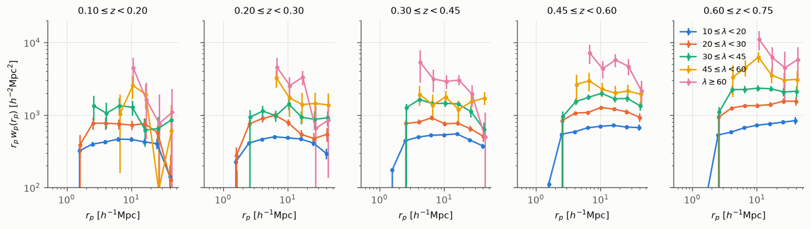
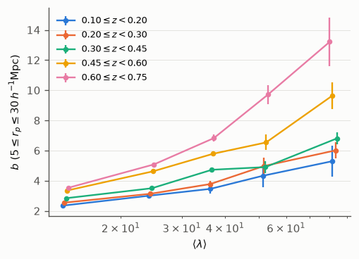
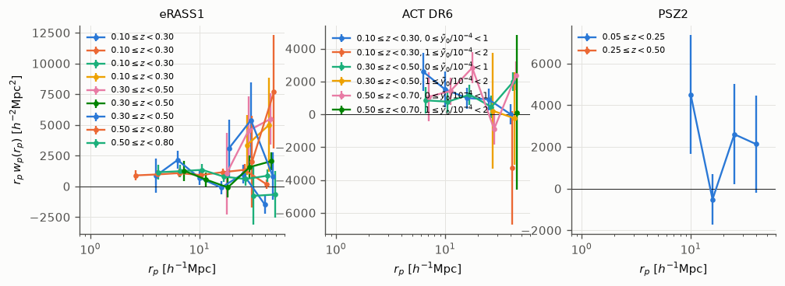
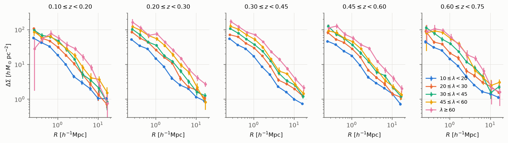
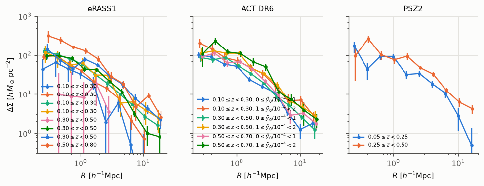
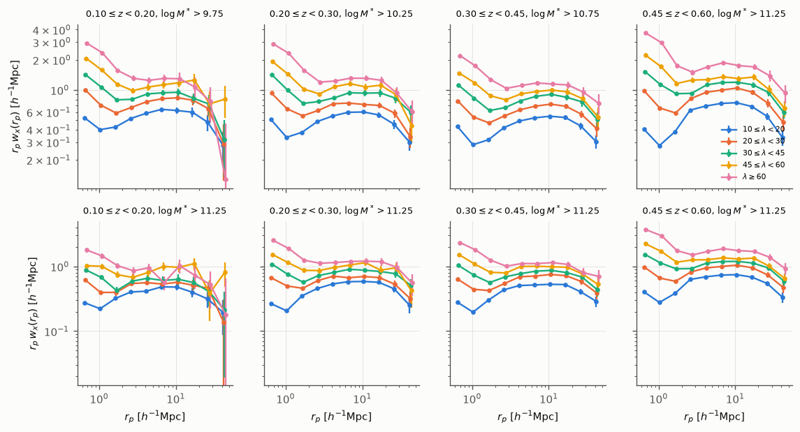
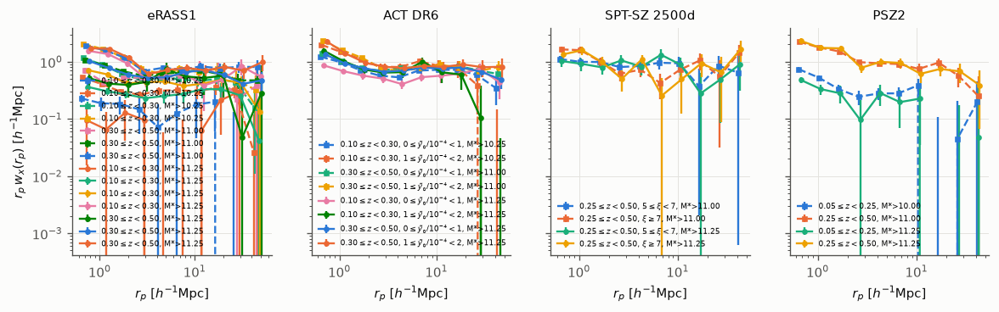
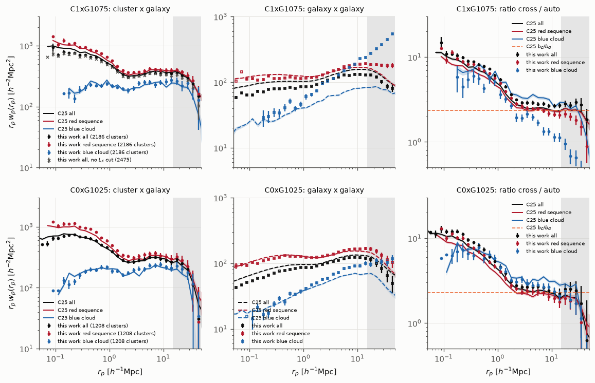
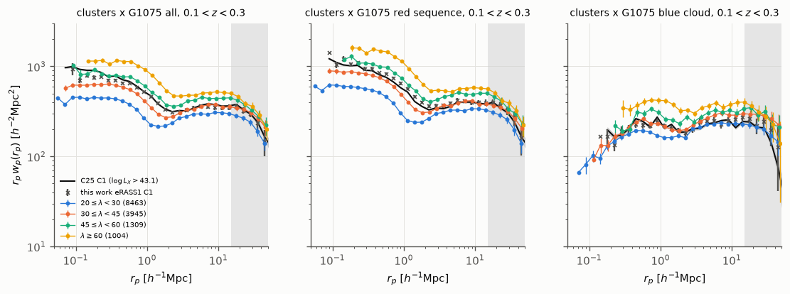

Clustering and lensing of the DR11 cluster samples
==================================================

We measured three summary statistics of the volume-limited cluster samples of :doc:`cluster_randoms`: the cluster auto-correlation :math:`w_p(r_p)`, the excess surface density :math:`\Delta\Sigma(R)` with three weak-lensing surveys, and the cross-correlation with the Legacy Surveys DR11 galaxies.
The samples are selected in richness (:math:`\lambda`), in X-ray luminosity (eRASS1) and in SZ signal (ACT DR6, SPT-SZ 2500d, PSZ2), and every measurement uses the weighted random catalogue of its sample.
The measurements were made on 2026-10-13 with version 0.6.0 of the summary statistics of ``sum_stat`` (branch ``cluster-stats``).
We compare the cross-correlation with the galaxies with :cite:t:`Comparat2025` (A&A 700, A271; C25 hereafter) in the last section; :doc:`erass1_dr11` gives the eRASS1 sample in detail.

Throughout, distances are comoving and in :math:`h^{-1}` Mpc, with the cosmology of the catalogue (flat ΛCDM, :math:`\Omega_{\rm m} = 0.3`, :math:`h = 0.7`).
:math:`\Delta\Sigma` is comoving, in :math:`h\,M_\odot\,{\rm pc}^{-2}`.
The uncertainties are :math:`1\sigma`, from a delete-one jackknife on 50 regions fitted (k-means) on the randoms of each sample.

.. contents:: Contents
   :local:
   :depth: 1

Cluster samples
---------------

.. list-table:: Cluster samples.
   N is the number of clusters below :math:`z_{\rm vlim}` (0.2 :math:`L_*` at 5σ) in the domain, with MASKFRAC < 0.2; each cluster has :math:`n_{\rm samp}` weighted random copies.
   :header-rows: 1
   :widths: 16 34 20 18 12

   * - Name
     - Selection
     - Redshift bins
     - Observable bins
     - N
   * - ``lambda_vlim``
     - :math:`\lambda \geq 10`, :math:`\lambda/{\rm SCALEVAL} \geq 3`
     - 0.10, 0.20, 0.30, 0.45, 0.60, 0.75
     - :math:`\lambda`: 10, 20, 30, 45, 60
     - 371 989
   * - ``lambda_vlim_s``
     - as above, with :math:`\lambda/{\rm SCALEVAL} \geq` the bin's lower edge
     - as above
     - as above
     - 312 029
   * - ``erass1``
     - eRASS1 extended sources, ``EXT_LIKE`` ≥ 6, rema optical confirmation on DR11
     - 0.10, 0.30, 0.50, 0.80
     - :math:`\log_{10} L_{500}` [erg s\ :sup:`-1`]: 43.1, 43.7, 44.3
     - 4 725
   * - ``act_dr6``
     - ACT DR6, fixed S/N ≥ 5, ``flags == 0``
     - 0.10, 0.30, 0.50, 0.70
     - :math:`\tilde y_0/10^{-4}`: 0, 1, 2
     - 3 191
   * - ``spt_2500d``
     - SPT-SZ 2500d, :math:`\xi \geq 5`
     - 0.25, 0.50, 0.75
     - :math:`\xi`: 5, 7
     - 238
   * - ``psz2_noise``
     - PSZ2 union, S/N ≥ 6, noise from the Planck 143 GHz hit counts
     - 0.05, 0.25, 0.50
     - none
     - 309

A bin with fewer than 50 clusters is not measured.
The eRASS1 randoms rest on our approximate detection model (:doc:`cluster_randoms`), since the selection function of :cite:t:`Clerc2024` is not available to us.

Cluster auto-correlation
------------------------

We measured :math:`w_p(r_p)` with the estimator of :cite:t:`LandySzalay1993` and Corrfunc :cite:p:`SinhaGarrison2020`, in ten logarithmic bins between 0.5 and 50 :math:`h^{-1}` Mpc, with :math:`\pi_{\max} = 100\,h^{-1}` Mpc and the cluster redshifts :math:`z_\lambda`.
The cluster randoms were drawn by weight, twenty per cluster, as in :cite:t:`McClintock2019` (Sect. 4.1.3).

   Projected cluster auto-correlation :math:`r_p\,w_p(r_p)` of ``lambda_vlim``, one panel per redshift bin, one colour per richness bin.
   The clustering increases with richness in every redshift bin.

The figure above shows the richness samples.
Below 1.5 :math:`h^{-1}` Mpc, :math:`w_p` is negative: the percolation leaves no pair of clusters at separations smaller than their radii.
At 10 :math:`h^{-1}` Mpc, :math:`w_p` rises from 46 ± 4 (:math:`10 \leq \lambda < 20`) to :math:`440 \pm 170\,h^{-1}` Mpc (:math:`\lambda \geq 60`) at :math:`0.10 \leq z < 0.20`, and from 72 ± 3 to :math:`1\,100 \pm 330\,h^{-1}` Mpc at :math:`0.60 \leq z < 0.75`.

   Large-scale bias of ``lambda_vlim`` against the mean richness of each bin, one line per redshift bin.
   The bias is :math:`b^2 = w_p/w_{p,\rm lin}`, fitted with the jackknife covariance over :math:`5 \leq r_p \leq 30\,h^{-1}` Mpc, with :math:`w_{p,\rm lin}` the linear matter :math:`w_p` (colossus, :cite:t:`Diemer2018`; :math:`\sigma_8 = 0.81`, :math:`n_s = 0.965`, :math:`\Omega_{\rm b} = 0.049`) integrated to the same :math:`\pi_{\max}`.

The bias of the :math:`10 \leq \lambda < 20` bin is 2.35 ± 0.07 at :math:`z = 0.15` and 3.53 ± 0.06 at :math:`z = 0.67`.
Below :math:`z = 0.3`, the bias of the :math:`\lambda \geq 60` bin (:math:`\langle\lambda\rangle = 82`) is 5.3 ± 1.0 and 6.0 ± 0.5.
Above :math:`z = 0.45` it reaches 9.7 ± 0.9 and 13.2 ± 1.6, the bias of haloes of :math:`10^{15}\,h^{-1}M_\odot` at these redshifts :cite:p:`Tinker2010`.
The ``lambda_vlim_s`` sample gives the same values within the errors.
The cluster density at :math:`z > 0.3` depends on the depth of the imaging, with up to 1.3 times more clusters in shallow sky (:doc:`cluster_randoms`), and the randoms do not correct it.
So the bias above :math:`z = 0.3` is an upper limit until systematic weights correct the density.

   Projected cluster auto-correlation :math:`r_p\,w_p(r_p)` of the X-ray and SZ samples, one colour per redshift and observable bin.
   SPT-SZ 2500d has no pair in most bins and is not shown.

For the X-ray and SZ samples, the signal-to-noise ratio is 1.9–5.1 for the eRASS1 bins of :math:`L_{500}` below :math:`z = 0.5` (:doc:`erass1_dr11`), 3.6–4.7 for the ACT DR6 bins with :math:`\tilde y_0 < 10^{-4}`, below one for the other ACT DR6 bins, and 2.3 for the low-redshift PSZ2 bin.

Excess surface density
----------------------

We measured :math:`\Delta\Sigma(R)` with dsigma :cite:p:`LangeHuang2022` in ten bins between 0.2 and 20 :math:`h^{-1}` Mpc, with the source catalogues of DES Y3 (metacalibration), HSC Y3 and KiDS-1000, the random-point subtraction and the boost factor.
The random points were drawn by weight from the cluster randoms, twenty per cluster.
We measured each survey separately on the 50 regions of the sample; the figures combine the surveys that overlap a bin with inverse-variance weights per radial bin.

   Excess surface density :math:`\Delta\Sigma(R)` of ``lambda_vlim``, one panel per redshift bin, one colour per richness bin, with DES Y3, HSC Y3 and KiDS-1000 combined.

At :math:`R = 1\,h^{-1}` Mpc, :math:`\Delta\Sigma` of the :math:`10 \leq \lambda < 20` bin is 14–18 :math:`h\,M_\odot\,{\rm pc}^{-2}` in every redshift bin (17.2 ± 0.8 at :math:`0.30 \leq z < 0.45`), and that of the :math:`\lambda \geq 60` bin is 56–75 (70.6 ± 6.6 at :math:`0.30 \leq z < 0.45`).
The three surveys agree within 1–2σ in every bin, and the signal-to-noise ratio of one survey in one bin is 5–42.
Each survey covers only 5–18 of the 50 jackknife regions, so the covariance of one survey is noisy and the signal-to-noise ratios use its diagonal.

   Excess surface density :math:`\Delta\Sigma(R)` of the X-ray and SZ samples, one colour per redshift and observable bin, with the surveys combined as for ``lambda_vlim``.

At :math:`R = 1\,h^{-1}` Mpc, eRASS1 gives 32 ± 8 to 63 ± 23 :math:`h\,M_\odot\,{\rm pc}^{-2}` from the lowest to the highest bin of :math:`L_{500}` at :math:`0.10 \leq z < 0.30` (:doc:`erass1_dr11`), ACT DR6 gives 52–68 for :math:`\tilde y_0 < 10^{-4}` and 72–112 above, and PSZ2 gives 90 ± 17 and 77 ± 18.
SPT-SZ 2500d has no lensing measurement.
The DES Y3 source file used here covers only :math:`-22.5° < \delta < 5.4°` (1 640 deg²), so only 350 of the 3 191 ACT DR6 clusters have DES sources, and neither HSC nor KiDS reaches the SPT field.
A full-footprint DES Y3 source file would give the SPT lensing and three times more ACT DR6 lenses.

Cross-correlation with DR11 galaxies in photo-z slices
-------------------------------------------------------

The galaxies are the stellar-mass volume-limited samples of the LS DR11 :math:`r < 21` selection (``bgsr21s``, made by ``ls11-rmagGAL``; LePhare stellar masses, photometric redshifts ``BEST_Z``), with their random catalogues and their systematic weights ``WEIGHT_SYS``.
Each sample is complete above its stellar-mass threshold between 0.10 and a maximum redshift, from 0.22 for :math:`\log_{10} M^* > 9.75` to 0.60 for :math:`\log_{10} M^* > 11.25`.
For each cluster bin :math:`[z_1, z_2)` we used the galaxies with :math:`z_1 - 0.05(1+z_1) \leq z_{\rm phot} < z_2 + 0.05(1+z_2)`.
We measured the angular cross-correlation at the distance of each cluster, :math:`w_x(r_p)`, with the Landy-Szalay estimator, the randoms of both samples and treecorr, between 0.5 and 50 :math:`h^{-1}` Mpc, on the area common to the two samples (84–98% of the clusters).
Each cluster bin is paired with the sample of lowest threshold that is complete to :math:`z_2`, and with :math:`\log_{10} M^* > 11.25`, the same tracer for every bin below :math:`z = 0.6`.
The amplitude of :math:`w_x` depends on the redshift distribution of the galaxies in the slice, so amplitudes compare within one galaxy sample only.

   Cluster-galaxy cross-correlation :math:`r_p\,w_x(r_p)` of ``lambda_vlim``, one column per redshift bin.
   Top: with the galaxy sample complete to the upper redshift of the bin.
   Bottom: with :math:`\log_{10} M^* > 11.25`.
   The excess at :math:`r_p < 2\,h^{-1}` Mpc is the galaxy population of the clusters.

The cross-correlation is detected in every bin, with a signal-to-noise ratio of 58–154 for the richness bins with the dense galaxy samples, and 22–110 with :math:`\log_{10} M^* > 11.25`.
At :math:`r_p = 1\,h^{-1}` Mpc, :math:`0.30 \leq z < 0.45` and :math:`\log_{10} M^* > 10.75`, :math:`w_x` rises from 0.28 (:math:`10 \leq \lambda < 20`) to 1.71 (:math:`\lambda \geq 60`); at 10 :math:`h^{-1}` Mpc it rises from 0.053 to 0.110.

   Cluster-galaxy cross-correlation :math:`r_p\,w_x(r_p)` of the X-ray and SZ samples, with the galaxy sample complete to the upper redshift of the bin (squares, dashed) and with :math:`\log_{10} M^* > 11.25` (circles).

The X-ray and SZ samples are detected with signal-to-noise ratios of 3–50 (eRASS1, per bin of :math:`L_{500}`), 16–49 (ACT DR6), 10–31 (PSZ2) and 10–15 (SPT-SZ 2500d).

.. _c25-comparison:

Comparison with Comparat et al. (2025)
--------------------------------------

We repeated the measurement of C25 (Sect. 3.1, Figs. 1 and 2) on the DR11 samples, and compare it with theirs in the first figure of this section.
C25 cross-correlated the volume-limited eRASS1 cluster samples of :cite:t:`Seppi2024` with stellar-mass volume-limited LS DR10 galaxies, split into red-sequence and blue-cloud galaxies.
We used their estimator and binning: the three-dimensional :math:`w_p(r_p)` with the cluster :math:`z_\lambda` and the galaxy photometric redshifts, the Landy-Szalay estimator with the randoms of both samples (Corrfunc), :math:`\pi_{\max} = 100\,h^{-1}` Mpc and 0.1 dex bins in :math:`r_p` (``scripts/measure_cluster_wp_cross.py`` of ``sum_stat``).
Their uncertainties come from 1 000 subsamples that each drop 10% of the area, with a 2% systematic floor; ours come from the delete-one jackknife on 50 regions.

.. list-table:: The two sample combinations of C25 (Table 1) and ours.
   N is the number of clusters or galaxies in the redshift range; RS and BC are the fractions of red-sequence and blue-cloud galaxies.
   :header-rows: 1
   :widths: 14 14 22 25 25

   * - Name
     - Redshift
     - Thresholds
     - N clusters (C25 / here)
     - N galaxies, RS, BC (C25 / here)
   * - C1xG1075
     - 0.1–0.3
     - :math:`\log_{10} L_X > 43.1`, :math:`\log_{10} M^* > 10.75`
     - 2 993 / 2 186
     - 2 480 941, 75%, 15% / 3 413 301, 67%, 26%
   * - C0xG1025
     - 0.1–0.2
     - :math:`\log_{10} L_X > 42.7`, :math:`\log_{10} M^* > 10.25`
     - 1 650 / 1 208
     - 2 255 070, 64%, 24% / 2 698 653, 58%, 33%

Our cluster samples are the eRASS1 clusters of the ``erass1`` sample above the same luminosity thresholds.
They hold 73% of the clusters of :cite:t:`Seppi2024`, at the same mean redshift (0.204 and 0.152, against 0.206 and 0.153).
Our galaxies are the ``ls11-rmagGAL`` samples above the same stellar-mass thresholds, cut to the same redshift ranges in ``BEST_Z``, with their systematic weights.
We split them as C25 did, with the colour cuts of :cite:t:`ComparatXray2025` (A&A 697, A173, Sect. 6.1): red sequence for :math:`g - z > {\rm RS}(z) - 0.15`, blue cloud for :math:`g - z < {\rm RS}(z) - 0.22`, with RS(z) the red-sequence colour of their Appendix D (:func:`sum_stat.selection.colour_class`).
The DR11 samples have 20–38% more galaxies above the same thresholds and a larger blue fraction; the LePhare stellar masses of DR11 differ from those of DR10.

   Projected cluster-galaxy cross-correlation (left), galaxy auto-correlation (middle) and their ratio (right), for C1xG1075 (top) and C0xG1025 (bottom), with all galaxies (black), the red sequence (red) and the blue cloud (blue).
   Lines and bands are C25, points this work; crosses are our C1 sample without the luminosity threshold.
   The dashed orange line is the ratio of large-scale biases :math:`b_C/b_G` of C25.
   The grey band is beyond 15 :math:`h^{-1}` Mpc, where C25 do not trust the measurement.

In the left panels, the cross-correlations agree.
Over :math:`3 < r_p < 15\,h^{-1}` Mpc the median ratio of ours to theirs is 0.97 (C1xG1075) and 1.02 (C0xG1025) for all galaxies, 1.05 and 1.08 for the red sequence, and 1.10 and 1.09 for the blue cloud.
Over :math:`0.1 < r_p < 1\,h^{-1}` Mpc it is 0.91 and 1.01 for all galaxies, 1.07 and 1.13 for the red sequence, and 0.90 and 1.00 for the blue cloud.
We reproduce the excess of red-sequence galaxies towards the cluster centres and the flattening of the blue-cloud profile below 0.3 :math:`h^{-1}` Mpc.
Without the luminosity threshold (2 475 clusters), the C1 cross-correlation is lower by 5% at all scales.

In the middle panels, the red-sequence auto-correlations agree (median ratio 0.97 and 0.99), while ours is lower for all galaxies (0.84 and 0.91), as the larger blue fraction implies.
The blue-cloud auto-correlation of G1075 has a large-scale excess, :math:`w_p(35\,h^{-1}{\rm Mpc}) = 12.6\,h^{-1}` Mpc against 2.4 for all galaxies, whereas that of G1025 follows C25.
The systematic weights and the randoms are those of the whole galaxy sample, so they do not correct a blue fraction that varies over the sky.
So the blue-cloud G1075 ratio in the right panel is not usable beyond 2 :math:`h^{-1}` Mpc; weights fitted on each colour class would be needed.

In the right panels, the ratio of the cross- to the auto-correlation over :math:`3 < r_p < 15\,h^{-1}` Mpc is 2.33 and 2.19 for the red sequence, in agreement with :math:`b_C/b_G` = 2.34 and 2.29 of C25.
For all galaxies it is 2.79 and 2.55, higher because our auto-correlation of all galaxies is lower.
Towards small scales the red-sequence ratio rises steadily, to about ten at 0.1 :math:`h^{-1}` Mpc, as in C25 (Figs. 1 and 2).

   Projected cross-correlation of the ``lambda_vlim`` clusters at :math:`0.1 < z_\lambda < 0.3` in four richness bins with G1075: all galaxies (left), red sequence (middle) and blue cloud (right).
   The line is C1xG1075 of C25, the crosses ours.

The figure above places the eRASS1 clusters among the richness bins.
Over :math:`3 < r_p < 15\,h^{-1}` Mpc the mean :math:`r_p w_p` of the four bins is 296, 355, 437 and 501 :math:`h^{-2}` Mpc², from :math:`20 \leq \lambda < 30` to :math:`\lambda \geq 60`.
C1 lies between the :math:`30 \leq \lambda < 45` and :math:`45 \leq \lambda < 60` bins: 349 (ours) and 360 (C25) on large scales, and 683 and 766 over :math:`0.1 < r_p < 1\,h^{-1}` Mpc, where the two bins give 579 and 778.
In every richness bin the red-sequence cross-correlation is 1.4–1.6 times the blue-cloud one on large scales, and the red-sequence excess towards the centre grows with richness.

Production of the measurements
------------------------------

.. code-block:: bash

   # cluster w_p and Delta Sigma (laptop: the lensing source catalogues are there)
   python scripts/measure_cluster_sumstat.py --sample lambda_vlim.fits --stats WP \
       --rp-bins-h log:10:0.5:50 --pi-max-h 100 --rand-ratio 20 --n-jk 50 --out lambda_vlim_wp.h5
   python scripts/measure_cluster_sumstat.py --sample lambda_vlim.fits \
       --stats ESD_DES ESD_HSC ESD_KIDS --rp-lens-bins-h log:10:0.2:20 --rand-ratio-lens 20 \
       --n-jk 50 --out lambda_vlim_esd.h5
   # cross-correlations with the LS DR11 galaxies (CC-IN2P3, where the galaxy samples are)
   scripts/cc_cluster_xgal.sh submit         # w_x in photo-z slices
   scripts/cc_cluster_xgal.sh submit-c25     # the 3D w_p of Comparat et al. (2025)
   # figures of this page
   python docs/figures/cluster_stats/make_all.py

The scripts are those of ``sum_stat``: ``scripts/measure_cluster_sumstat.py``, ``scripts/measure_cluster_wp_cross.py`` and ``scripts/cc_cluster_xgal.sh``.
The figures read the measurements from ``$REMA_WORK/cluster_sumstat`` and the files of C25 from ``$CXG_DATA``.
