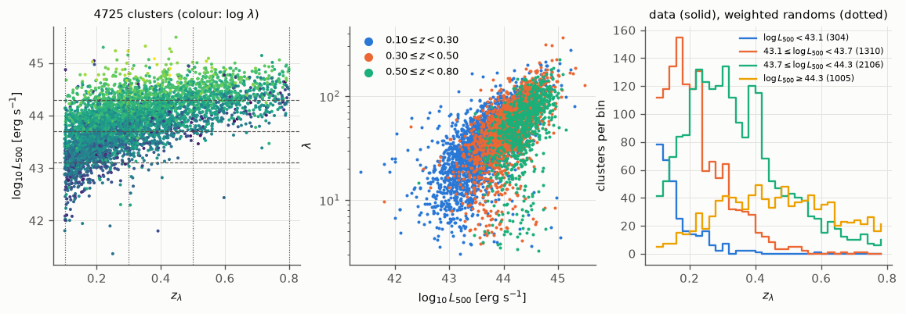
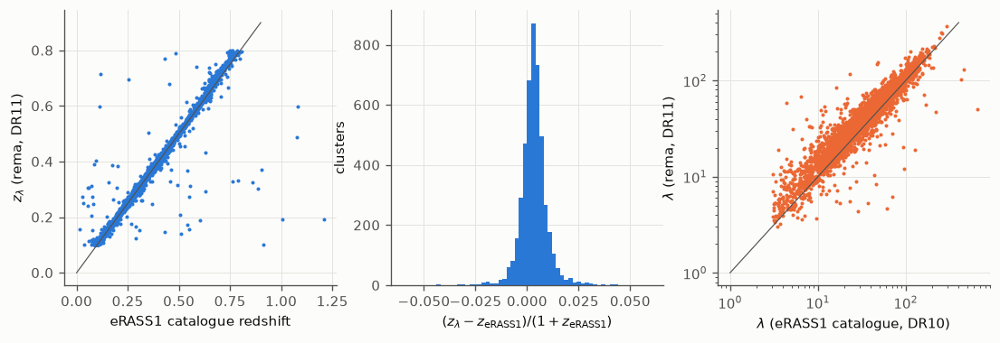
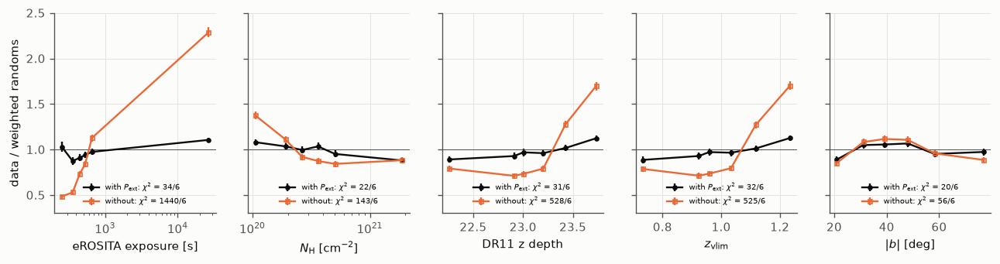
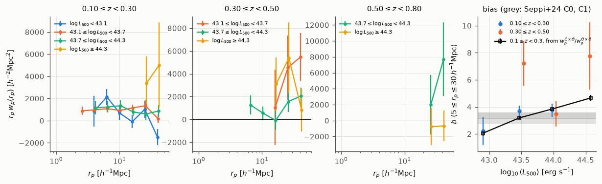
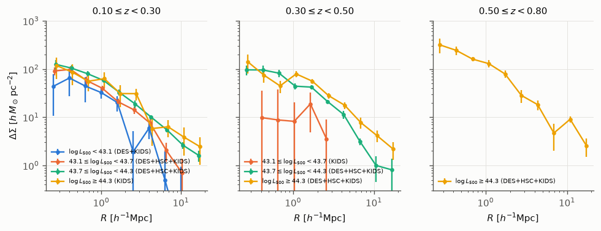
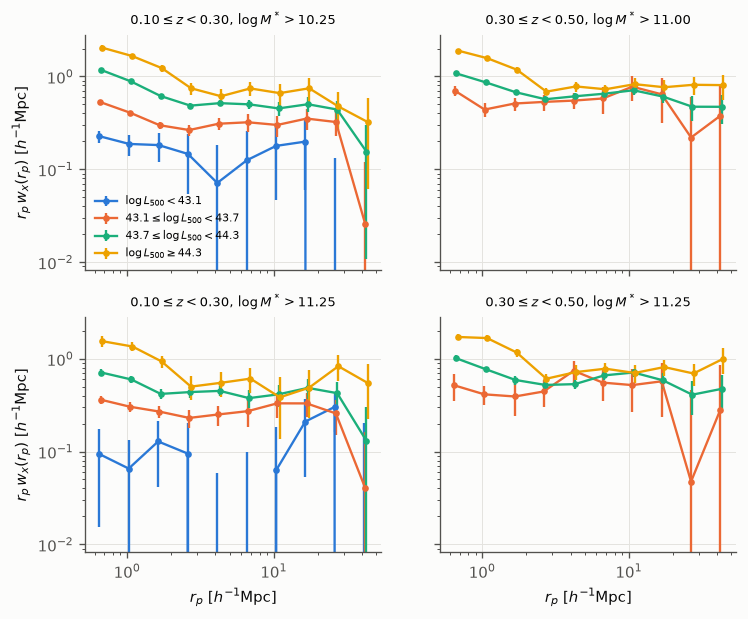
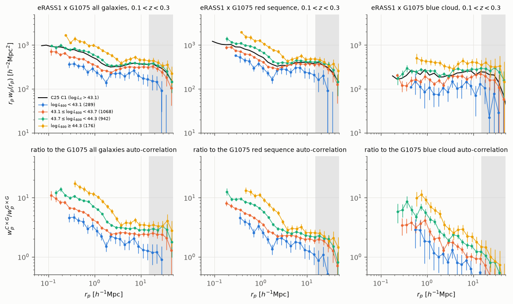

eRASS1 clusters on DR11
=======================

We measured the clustering, the lensing and the cross-correlation with the DR11 galaxies of the eRASS1 clusters confirmed by rema on the Legacy Surveys DR11, in bins of X-ray luminosity.
The inputs are the rema scan of the eRASS1 primary cluster catalogue of :cite:t:`Bulbul2024` (:doc:`public_catalogues_scan`), the approximate eRASS1 detection model of :doc:`cluster_randoms`, the lensing source catalogues of DES Y3, HSC Y3 and KiDS-1000, and the stellar-mass selected DR11 galaxy samples of ``ls11-rmagGAL``.
The measurements were made on 2026-10-14 with the summary statistics of ``sum_stat`` (branch ``cluster-stats``); :doc:`cluster_statistics_dr11` describes the methods and the other samples.
We describe the sample and its random catalogue, then the auto-correlation, the excess surface density, the cross-correlation in photo-z slices, and the dependence of the cluster-galaxy cross-correlation on luminosity.

The conventions are those of :doc:`cluster_statistics_dr11`: comoving distances in :math:`h^{-1}` Mpc with :math:`\Omega_{\rm m} = 0.3` and :math:`h = 0.7`, :math:`1\sigma` uncertainties from a delete-one jackknife on 50 regions, and :math:`\Delta\Sigma` in comoving :math:`h\,M_\odot\,{\rm pc}^{-2}`.
:math:`L_{500}` is the soft-band luminosity within :math:`R_{500}` of the eRASS1 catalogue, in erg s\ :sup:`-1`; the catalogue column is in units of :math:`10^{42}` erg s\ :sup:`-1`.

.. contents:: Contents
   :local:
   :depth: 1

Sample selection
----------------

The eRASS1 primary catalogue lists 12 247 clusters in the Western Galactic hemisphere.
We scanned each position with rema on DR11 and kept the clusters with a measured richness, a detection likelihood ``EXT_LIKE`` ≥ 6, and :math:`0.10 \leq z_\lambda < 0.80`.
We then kept those in the area of the DR11 run, below the volume limit :math:`z_{\rm vlim}` (0.2 :math:`L_*` at 5σ) at their position, with MASKFRAC < 0.2 and :math:`\lambda/{\rm SCALEVAL} \geq 3`.
We did not cut on the eRASS1 contamination probability ``PCONT`` nor on its DR10 volume-limit flag, since the DR11 randoms cannot reproduce them.

.. list-table:: Cut-flow of the eRASS1 sample.
   :header-rows: 1
   :widths: 60 20

   * - Step
     - Clusters
   * - eRASS1 primary catalogue
     - 12 247
   * - scanned by rema on DR11
     - 12 204
   * - richness measured (:math:`\lambda > 0`)
     - 11 770
   * - ``EXT_LIKE`` ≥ 6
     - 6 567
   * - :math:`0.10 \leq z_\lambda < 0.80`
     - 5 382
   * - in the run area, below :math:`z_{\rm vlim}`, MASKFRAC < 0.2, :math:`\lambda/{\rm SCALEVAL} \geq 3`
     - 4 725

We binned the sample in three redshift bins and four bins of :math:`\log_{10} L_{500}`, with edges at 43.1, 43.7 and 44.3; 43.1 is the threshold of the C1 sample of :cite:t:`Seppi2024` and :cite:t:`Comparat2025`.
A bin with fewer than 50 clusters is not measured.

.. list-table:: Number of clusters per bin.
   The median richness of the four luminosity bins is 16, 28, 48 and 78.
   :header-rows: 1
   :widths: 20 20 20 20 20

   * - Redshift
     - :math:`\log L_{500} < 43.1`
     - 43.1–43.7
     - 43.7–44.3
     - ≥ 44.3
   * - 0.10–0.30
     - 289
     - 1 068
     - 942
     - 176
   * - 0.30–0.50
     - 14
     - 226
     - 866
     - 401
   * - 0.50–0.80
     - 1
     - 16
     - 298
     - 428

   The eRASS1 sample.
   Left: :math:`\log_{10} L_{500}` against :math:`z_\lambda`, coloured by :math:`\log_{10}\lambda`, with the bin edges (dashed and dotted).
   Middle: richness against luminosity, one colour per redshift bin.
   Right: redshift distribution of each luminosity bin, for the clusters (solid) and the weighted randoms (dotted).

In the left panel, the luminosity of the sample rises with redshift, so the faint bins are populated at low redshift only.
In the middle panel, richness and luminosity correlate, :math:`\lambda \propto L_{500}^{0.38}`, with a scatter of 0.19 dex in :math:`\lambda` at fixed :math:`L_{500}` (normalised median absolute deviation).
48 clusters with :math:`\log L_{500} > 44` have :math:`\lambda < 10`; their :math:`z_\lambda` agrees with the eRASS1 redshift to a median :math:`|\Delta z|/(1+z)` of 0.019, and they remain in the sample.
In the right panel, the weighted randoms reproduce the redshift distribution of every bin, by construction.

   The rema measurements on DR11 against the eRASS1 catalogue, for the 4 725 clusters.
   Left and middle: :math:`z_\lambda` against the catalogue redshift, and their difference.
   Right: :math:`\lambda` against the redMaPPer richness of the catalogue (DR10).

Our :math:`z_\lambda` agrees with the eRASS1 redshift: the median of :math:`(z_\lambda - z_{\rm eRASS1})/(1+z_{\rm eRASS1})` is 0.003, its normalised median absolute deviation 0.005, and 1.2% of the clusters differ by more than 0.05.
Our richness is 1.18 times the DR10 richness of the catalogue (16th–84th percentiles: 1.01–1.42).
The luminosities are those of the catalogue, computed at its redshift; with an offset of 0.003 in redshift, we did not correct them.

Random catalogue
----------------

Each cluster has 500 random copies, placed where the DR11 catalogue is volume limited at its redshift and weighted by the probability that eRASS1 detects it there (:doc:`cluster_randoms`).
The detection model is our approximation, since the selection function of :cite:t:`Clerc2024` is not available to us.
It moves the counts of the cluster with the eRASS1 exposure (0.27 times that of eRASS:4) and the Galactic absorption, and predicts ``EXT_LIKE`` from a regression of :math:`\ln` ``EXT_LIKE`` on the counts and the angular size, fitted on the catalogue.
The effective number of copies per cluster has a median of 399 and a first percentile of 36: clusters close to the detection threshold have a few copies with large weights.

   Ratio of the clusters to the weighted randoms, in six bins of the eROSITA exposure, the HI column density, the DR11 depth in the z band, :math:`z_{\rm vlim}` and the Galactic latitude (from left to right).
   Black: with the eRASS1 detection probability; orange: without it (DR11 selection only).

With the detection probability, the ratio stays within 0.87–1.13 in every map, with :math:`\chi^2` = 34, 22, 31, 32 and 20 for six bins against the exposure, the column density, the depth, :math:`z_{\rm vlim}` and the latitude.
Without it, the ratio runs from 0.49 at the lowest exposure to 2.29 at the highest (:math:`\chi^2` = 1 440), and from 0.71 to 1.70 against the depth (:math:`\chi^2` = 528).
The remaining trends are at the 10% level, larger than the Poisson errors; they set the precision of the approximate model until the eRASS1 selection function is released.

Cluster auto-correlation
------------------------

We measured :math:`w_p(r_p)` as for the other samples (:doc:`cluster_statistics_dr11`): Landy-Szalay with Corrfunc, ten bins between 0.5 and 50 :math:`h^{-1}` Mpc, :math:`\pi_{\max} = 100\,h^{-1}` Mpc, twenty randoms per cluster drawn by weight.
We fitted the large-scale bias over :math:`5 \leq r_p \leq 30\,h^{-1}` Mpc against the linear matter :math:`w_p`.

   Projected auto-correlation :math:`r_p\,w_p(r_p)` of the eRASS1 luminosity bins (colours) in the three redshift bins (first three panels).
   Right: large-scale bias against the mean luminosity of each bin, from the auto-correlation (filled circles, one colour per redshift bin) and from the cross-correlation with the galaxies at :math:`0.10 \leq z < 0.30` (open squares, Sect. `Luminosity dependence of the cluster-galaxy cross-correlation`_).
   The grey bands are the biases of the C0 and C1 samples of :cite:t:`Seppi2024`.

The auto-correlation of a luminosity bin has a signal-to-noise ratio of 2.1–5.1 at :math:`0.10 \leq z < 0.30`, 1.9–3.9 at :math:`0.30 \leq z < 0.50` and below two above.
At :math:`0.10 \leq z < 0.30` the bias is 2.2 ± 1.1, 3.7 ± 0.4 and 3.8 ± 0.5 in the three fainter bins; the brightest bin (176 clusters) has no pair below 13 :math:`h^{-1}` Mpc in the fitting range, and no fit.
The C1 sample of :cite:t:`Seppi2024`, :math:`\log L_X > 43.1` at :math:`0.1 < z < 0.3`, has :math:`b = 3.35 \pm 0.23`, compatible with our two middle bins.
At :math:`0.30 \leq z < 0.50` the bias is 7.2 ± 1.7, 3.5 ± 0.9 and 7.8 ± 2.5.
The depth-dependent cluster density of DR11 above :math:`z = 0.3` adds large-scale power (:doc:`cluster_statistics_dr11`), so these values are upper limits.

Excess surface density
----------------------

We measured :math:`\Delta\Sigma(R)` as for the other samples, with the DES Y3, HSC Y3 and KiDS-1000 sources, and combined the surveys with inverse-variance weights per radial bin.
A survey enters a bin only if at least ten clusters have sources.

   Excess surface density :math:`\Delta\Sigma(R)` of the eRASS1 luminosity bins (colours) in the three redshift bins; the legend lists the lensing surveys of each bin.

At :math:`R = 1\,h^{-1}` Mpc and :math:`0.10 \leq z < 0.30`, :math:`\Delta\Sigma` rises with luminosity: 32 ± 8, 40 ± 5, 58 ± 4 and 63 ± 23 :math:`h\,M_\odot\,{\rm pc}^{-2}` from the faintest to the brightest bin.
At :math:`0.30 \leq z < 0.50` it is 44 ± 7 and 79 ± 12 in the two brighter bins, while the 43.1–43.7 bin gives 8 ± 12.
At :math:`0.50 \leq z < 0.80` the brightest bin gives 129 ± 23; the 43.7–44.3 bin has fewer than ten clusters with sources in every survey.
The brightest bin at :math:`0.10 \leq z < 0.30` and the 43.1–43.7 bin at :math:`0.30 \leq z < 0.50` rest on KiDS alone, since the DES Y3 source file used here covers only 1 640 deg² (:math:`-22.5° < \delta < 5.4°`).

Cross-correlation with DR11 galaxies in photo-z slices
-------------------------------------------------------

We measured the angular cross-correlation :math:`w_x(r_p)` with the DR11 galaxies in a photo-z slice around each cluster bin, as for the other samples, with :math:`\log_{10} M^* > 10.25` at :math:`0.10 \leq z < 0.30`, :math:`\log_{10} M^* > 11.00` at :math:`0.30 \leq z < 0.50`, and :math:`\log_{10} M^* > 11.25` for both.

   Cross-correlation :math:`r_p\,w_x(r_p)` of the eRASS1 luminosity bins (colours) at :math:`0.10 \leq z < 0.30` (left) and :math:`0.30 \leq z < 0.50` (right).
   Top: with the galaxy sample complete to the upper redshift of the bin.
   Bottom: with :math:`\log_{10} M^* > 11.25`.

The cross-correlation rises with luminosity at every scale.
Its signal-to-noise ratio is 8.5, 24.8, 49.5 and 19.7 in the four bins at :math:`0.10 \leq z < 0.30` with :math:`\log_{10} M^* > 10.25`, and 15.2, 40.4 and 22.9 in the three bins at :math:`0.30 \leq z < 0.50` with :math:`\log_{10} M^* > 11.00`.

Luminosity dependence of the cluster-galaxy cross-correlation
-------------------------------------------------------------

We measured the three-dimensional cross-correlation of each luminosity bin at :math:`0.1 < z < 0.3` with the galaxies of :math:`\log_{10} M^* > 10.75` at :math:`0.1 < z_{\rm phot} < 0.3` (G1075), with the set-up of :cite:t:`Comparat2025`: the Landy-Szalay estimator with the randoms of both samples, the galaxy photometric redshifts, :math:`\pi_{\max} = 100\,h^{-1}` Mpc and 0.1 dex bins.
We split the galaxies into the red sequence and the blue cloud with the colour cuts of :cite:t:`ComparatXray2025` (A&A 697, A173, Sect. 6.1; :doc:`cluster_statistics_dr11`), and divided each cross-correlation by the auto-correlation of the same galaxies.

   Top: projected cross-correlation :math:`r_p\,w_p(r_p)` of the eRASS1 luminosity bins at :math:`0.1 < z < 0.3` with G1075, for all galaxies (left), the red sequence (middle) and the blue cloud (right); the black line is C1xG1075 of :cite:t:`Comparat2025`.
   Bottom: ratio to the auto-correlation of the same galaxies.
   The grey band is beyond 15 :math:`h^{-1}` Mpc.

In the top-left panel the amplitude rises with luminosity at all scales: over :math:`3 < r_p < 15\,h^{-1}` Mpc the mean :math:`r_p w_p` is 207, 309, 373 and 456 :math:`h^{-2}` Mpc², and over :math:`0.1 < r_p < 1\,h^{-1}` Mpc it is 319, 543, 810 and 1 221 :math:`h^{-2}` Mpc².
C1xG1075 of :cite:t:`Comparat2025`, all clusters above :math:`\log L_X = 43.1`, lies between our second and third bins, with 360 and 766 :math:`h^{-2}` Mpc² over the same ranges.
The red-sequence cross-correlation follows the same order, with a steeper rise towards the centre; the blue-cloud one is flat below 1 :math:`h^{-1}` Mpc in every bin.

In the bottom-left panel, the ratio over :math:`3 < r_p < 15\,h^{-1}` Mpc is 1.60 ± 0.15, 2.48 ± 0.07, 2.99 ± 0.07 and 3.63 ± 0.17.
On these scales it is the ratio of the cluster and galaxy biases, :math:`b_C/b_G` :cite:p:`Comparat2025{Eq. 1}`.
For G1075 we find :math:`b_G = 1.29 \pm 0.01`, from its auto-correlation over :math:`5 < r_p < 15\,h^{-1}` Mpc against the linear matter :math:`w_p` at :math:`z = 0.2`.
The cluster bias is then 2.06 ± 0.19, 3.19 ± 0.10, 3.84 ± 0.10 and 4.67 ± 0.23 at :math:`\log\langle L_{500}\rangle` = 42.90, 43.47, 43.98 and 44.58.
With the bias of :cite:t:`Tinker2010` at :math:`z = 0.2`, these correspond to :math:`\log_{10} M_{\rm 200m}/(h^{-1}M_\odot)` = 13.8, 14.3, 14.5 and 14.6.
:cite:t:`Seppi2024` found :math:`b = 3.35 \pm 0.23` for C1, whose mean luminosity (:math:`\log L_X = 43.87`) lies between our second and third bins.
:cite:t:`Comparat2025` quote :math:`b_G = 1.43` for their G1075; our DR11 sample has a larger blue fraction and a lower auto-correlation (:doc:`cluster_statistics_dr11`).
This cluster bias is four times more precise than that of the auto-correlation, but it rests on the galaxy bias.
Towards small scales the ratio rises in every bin; at 0.3 :math:`h^{-1}` Mpc it is 4.6, 6.7, 9.9 and 14.2.

In the middle and right panels, the red-sequence ratio is 1.46 ± 0.14, 2.16 ± 0.07, 2.45 ± 0.06 and 2.79 ± 0.14 on large scales, and rises steadily towards the centre, as in :cite:t:`Comparat2025` (Figs. 1 and 2).
The blue-cloud ratio falls on large scales, because the blue-cloud auto-correlation of G1075 has a spurious large-scale excess (:doc:`cluster_statistics_dr11`).
Below 2 :math:`h^{-1}` Mpc it rises towards the centre in every bin, more steeply in the brighter ones.
The blue-cloud classes use the systematic weights and the randoms of the whole galaxy sample; weights fitted on each colour class would be needed to use the blue-cloud ratio on large scales.

Production of the measurements
------------------------------

.. code-block:: bash

   # the sample (CC-IN2P3): the copies of cluster-randoms copies, binned with scripts/randoms/erass1.yaml
   rema cluster-randoms sample --clusters erass1_joined.fits --config catalog_config.yaml \
       --spec erass1.yaml --zvlim zvlim_dr11.fits --domain domain.fits --copies copies_erass1.fits \
       --keep RA_OPT --keep DEC_OPT --keep INPUT_NAME --out erass1.fits
   # w_p and the cross-correlations (CC-IN2P3, sum_stat scripts/cc_cluster_xgal.sh)
   WP_SAMPLES=erass1 scripts/cc_cluster_xgal.sh submit-wp
   ARRAY=5,9,15 scripts/cc_cluster_xgal.sh submit       # w_x in photo-z slices
   ARRAY=25-36 scripts/cc_cluster_xgal.sh submit-c25    # luminosity bins x G1075 (all, RS, BC)
   # Delta Sigma (laptop, with the source catalogues)
   python scripts/measure_cluster_sumstat.py --sample erass1.fits --stats ESD_DES ESD_HSC ESD_KIDS \
       --rp-lens-bins-h log:10:0.2:20 --rand-ratio-lens 20 --n-jk 50 --out erass1_esd.h5
   # figures of this page
   python docs/figures/cluster_stats/fig_erass1.py
