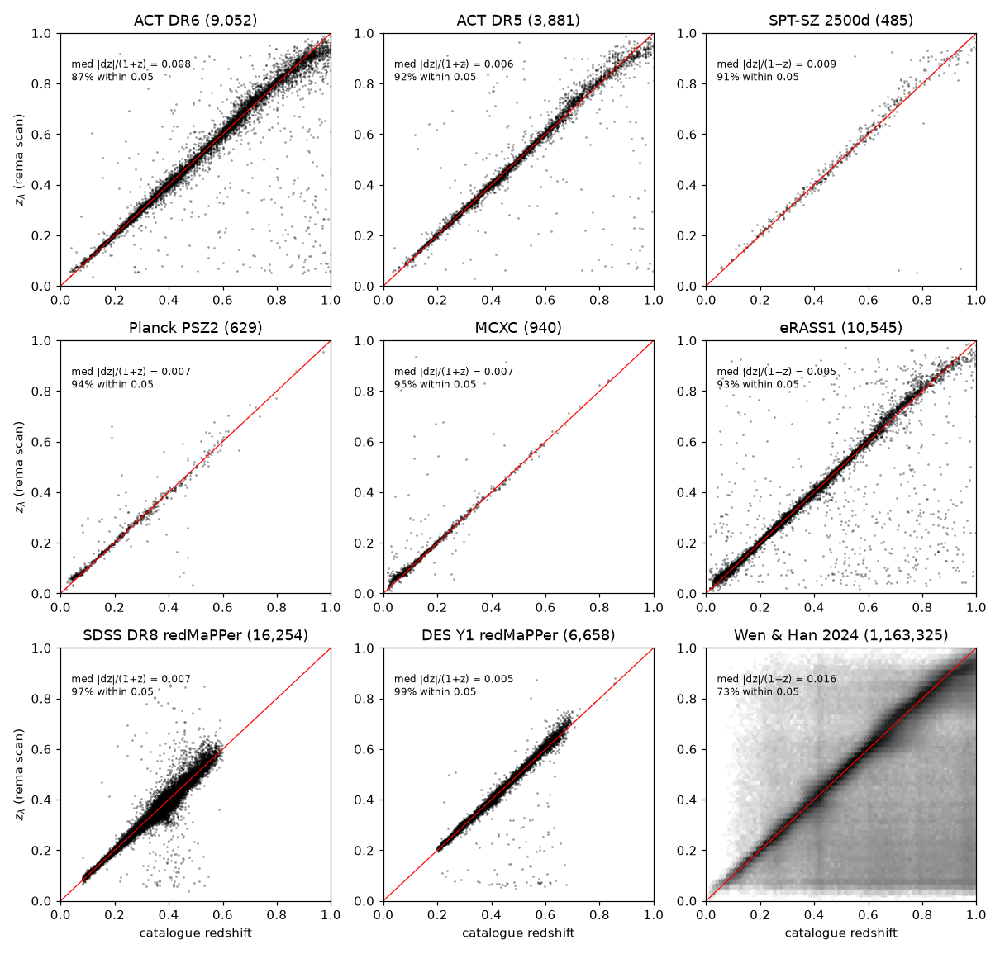
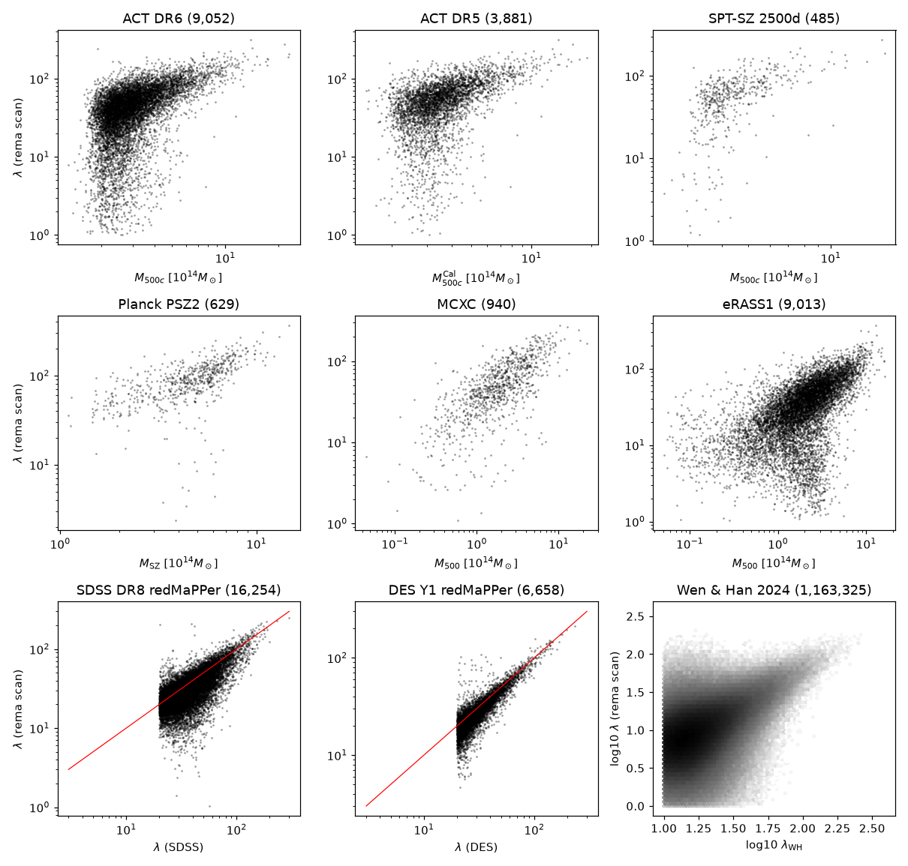
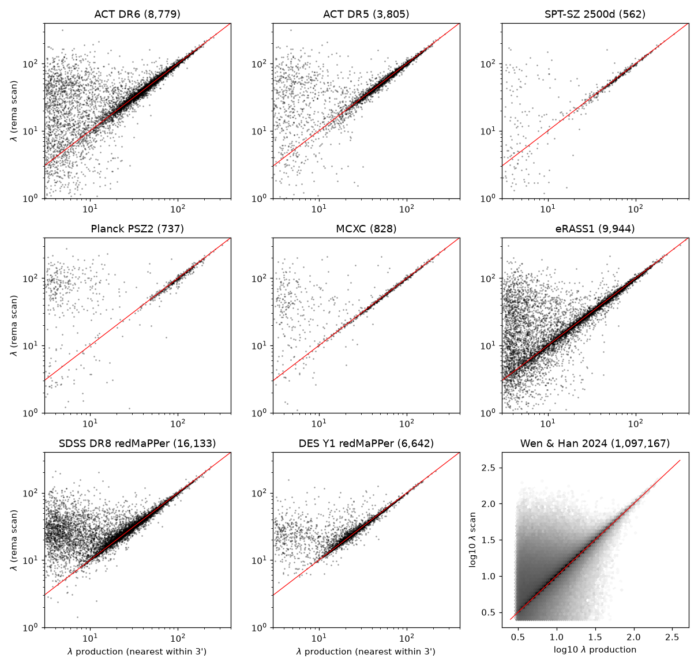

Public cluster catalogues in DR11
==================================

rema measured the richness λ, the redshift z_λ, the optical centre and, where members have one,
the spectroscopic redshift at the position of every cluster of nine public catalogues, in the
DR11 south data. The SZ catalogues are ACT DR5, ACT DR6, SPT-SZ 2500d and Planck PSZ2; the X-ray
ones are MCXC and eRASS1; the optical ones are SDSS DR8 redMaPPer, DES Y1 redMaPPer and Wen & Han
(2024) (papers under `References`_). The positions were measured in scan mode, with the
calibration of the DR11 south production run (:doc:`ccin2p3`). The products are on the CC-IN2P3
data system, one FITS file per catalogue, row for row with the catalogue:

.. code-block:: text

   /sps/lsst/datasets/desi/legacysurveys/dr11/south/rema/rema_dr11_v0.2.0_scan_public/

On the laptop the same directory is under ``$REMA_DATA`` (``~/data/legacysurvey/dr11/south/rema``).

Products
--------

.. list-table::
   :header-rows: 1
   :widths: 30 70

   * - File
     - Content
   * - ``<catalogue>.fits``
     - ``act_dr5``, ``act_dr6``, ``spt_2500d``, ``psz2``, ``mcxc``, ``erass1``, ``sdss_dr8``,
       ``des_y1``, ``wen_han_2024``. HDUs ``CLUSTERS``, ``MEMBERS`` and ``CONFIG`` (as
       :doc:`reference`, "rema scan-positions").
   * - ``summary.json``
     - Rows, scanned, λ > 0, λ > 20 and members per catalogue.
   * - ``inputs/``
     - The input tables, from ``scripts/scan/public_catalogues.py``. Wen & Han is in 24 slices
       of 15° in RA, ``wen_han_2024_ra<RA0>.fits``.
   * - ``logs/``
     - The logs of the scan jobs.
   * - ``README.txt``
     - A short description.

``CLUSTERS`` has one row per cluster of the catalogue, in its order:

- **The catalogue's own columns,** as ``INPUT_<NAME>``: ``INPUT_RA``, ``INPUT_DEC``,
  ``INPUT_Z``, and the mass, richness or S/N under common names (``INPUT_M500`` in
  10¹⁴ M☉, ``INPUT_LAMBDA``, ``INPUT_SNR``, ``INPUT_LX`` in 10⁴⁴ erg/s, ...). ``INPUT_ROW``
  is the row in the original file, in ``dr11/south/rema/external``. The mappings are in
  ``scripts/scan/public_catalogues.py``.
- **The scan-mode columns:**

  - ``LAMBDA`` and ``Z_LAMBDA`` at the catalogue position;
  - ``RA_OPT``, ``DEC_OPT``, ``LAMBDA_OPT`` and ``Z_LAMBDA_OPT`` at the optical centre;
  - the redshift scan: ``Z_STEPS``, ``LAMBDA_STEPS``, ``ZMAX`` and ``ZMAX_EDGE``;
  - ``MASKFRAC`` and ``SCALEVAL``;
  - the centring probabilities.
- **The spectroscopic columns:** ``NSPEC``, ``SPEC_Z``, ``VDISP``, ``BEST_Z`` and
  ``BEST_Z_TYPE``, from the `Clerc et al. (2016) <https://doi.org/10.1093/mnras/stw2214>`__ clipping
  of the members with a spectroscopic
  redshift (``ZSPEC`` of the DR11 photo-z sweeps: DESI, SDSS/BOSS/eBOSS, GAMA, 2dFLenS, ...).
- **SCANNED:** false for a position outside the DR11 south sweeps; the rema columns are −1
  there.

``MEMBERS`` holds the members with their probabilities, keyed by ``MEM_MATCH_ID``, the row of
the cluster in ``CLUSTERS``.

Selecting the good rows
-----------------------

The scan reports every position that falls in a DR11 south sweep, also those outside the
survey footprint: the north of SDSS, masked areas and the edges of the survey. Apply the cut of
the production catalogue:

.. code-block:: python

   from astropy.io import fits

   c = fits.getdata("act_dr6.fits", "CLUSTERS")
   good = c["SCANNED"] & (c["LAMBDA"] > 0) & (c["MASKFRAC"] < 0.2)

Outside the footprint ``MASKFRAC`` is 1, the completeness correction ``SCALEVAL`` diverges, and
λ comes out at about 1,700 with z_λ at the lower bound of the scan, 0.05. The cut removes all of
these rows: 2,825 of SDSS DR8 and 185 of ACT DR6, for example. A z_λ of 0.05 that survives the
cut is a cluster at or below the lower limit of the redshift scan (``ZMAX_EDGE`` true); most are
low-redshift MCXC and eRASS1 clusters. Like the production catalogue, the products are cut neither
in Galactic latitude nor in E(B-V) (the ingestion only drops galaxies with E(B-V) ≥ 0.2). The
production catalogue keeps \|b\| > 15°.

Comparison
----------

These measurements were not checked cluster by cluster against the catalogues' own analyses. The
table compares them with the catalogues' redshifts and with the DR11 south production catalogue
(``rema_dr11_v0.2.0``). The "matched" clusters are those with a production cluster within 3′ of
the scan's centre. The two columns "λ / production" and "\|Δz\| production" are medians over the
matched clusters. "\|Δz\|/(1+z) catalogue" and "Within 0.05" use the catalogue's redshift, where
it has one.

.. include:: figures/public_scan/comparison.rst

- **Agreement with the production catalogue:** λ agrees to 0–3% and z_λ to 0.003 or better in
  median, as expected, since both use the same calibration and data.
- **The scatter below the 1:1 line** in the figure comes from the 3′ match: the nearest
  production cluster is often a small neighbour, while the production run assigned the main
  cluster elsewhere or percolated it away.
- **The catalogues' redshifts** are recovered to 0.005–0.009 in median for the SZ, X-ray and
  redMaPPer catalogues, 87–99% of them within 0.05. Wen & Han is at 0.016 and 73%: most of its
  clusters are poor (170,423 of the 1,163,325 good rows have λ > 20).
- **z_λ above 0.8** falls below the catalogue redshifts (ACT DR6 and eRASS1, the top-right
  corners): the DR11 photometry and the red-sequence model run out there, as for the production
  catalogue.

   z_λ at the catalogue positions against the catalogue redshifts. The red line is 1:1.

   λ against the catalogue mass (SZ and X-ray) or richness (redMaPPer, Wen & Han). The red line
   is 1:1 for the richness panels.

   λ at the catalogue positions against λ of the nearest production cluster within 3′.

How it was made
---------------

The run took place on 2026-10-11 at CC-IN2P3, with the commands of :doc:`ccin2p3`, "Your own
positions":

1. **Ingest and randoms index:** ``scripts/slurm/rema_dr11_blind.sh prepare`` with
   ``OUTDIR=/sps/lsst/users/$USER/rema_scan``. All 1,600 sweeps were ingested (about 80 GB) and
   the randoms files 0–3 indexed once, as CPU arrays. The survey hash of the configuration
   matches the production calibration, so the tables are those of the production.
2. **Inputs:** ``scripts/scan/public_catalogues.py`` wrote the nine catalogues, and Wen & Han in
   RA slices.
3. **Validation:** 20 random clusters of each catalogue gave the same λ and z_λ as the
   production catalogue (median λ ratio 1.00–1.02, \|Δz\| ≤ 0.001 where the clusters match).
4. **Scans:** one V100 job per catalogue or slice, 32 in all (``scripts/scan/scan_positions.sh``
   with ``--index`` on the shared randoms index, 90 GB of memory). They took 7 min to 2.5 h each.
   The Wen & Han slices, 13,733 to 114,426 positions each, took 7 min to 1.3 h each, 15 h of
   GPU time for its 1.38 M scanned positions.
5. **Final step:** ``scripts/scan/finalize_scan.sh`` joined the slices with
   ``scripts/scan/merge_parts.py`` and checked that every output has one row per input row. It
   then copied everything to the data system, compared the copies byte for byte and deleted the
   work directory.

The headers carry ``REMAVER = 0.4.0``: the scans ran on the development version that became
0.5.0, with ``rema scan-positions`` and the two fixes of this release.

To reproduce the figures and the table:

.. code-block:: bash

   python docs/figures/public_scan/make_figures.py \
       $REMA_DATA/rema_dr11_v0.2.0_scan_public $REMA_DATA/rema_dr11_v0.2.0/clusters_dr11.fits

References
----------

- ACT DR5: Hilton et al. (2021), `ApJS 253, 3 <https://doi.org/10.3847/1538-4365/abd023>`__
  (`arXiv:2009.11043 <https://arxiv.org/abs/2009.11043>`__).
- ACT DR6: ACT-DES-HSC Collaboration (2026), `OJAp 9 <https://doi.org/10.33232/001c.155863>`__
  (`arXiv:2507.21459 <https://arxiv.org/abs/2507.21459>`__).
- SPT-SZ 2500d: Bocquet et al. (2019), `ApJ 878, 55 <https://doi.org/10.3847/1538-4357/ab1f10>`__
  (`arXiv:1812.01679 <https://arxiv.org/abs/1812.01679>`__).
- Planck PSZ2: Planck Collaboration (2016), `A&A 594, A27 <https://doi.org/10.1051/0004-6361/201525823>`__
  (`arXiv:1502.01598 <https://arxiv.org/abs/1502.01598>`__).
- MCXC: Piffaretti et al. (2011), `A&A 534, A109 <https://doi.org/10.1051/0004-6361/201015377>`__
  (`arXiv:1007.1916 <https://arxiv.org/abs/1007.1916>`__).
- eRASS1: Bulbul et al. (2024), `A&A 685, A106 <https://doi.org/10.1051/0004-6361/202348264>`__
  (`arXiv:2402.08452 <https://arxiv.org/abs/2402.08452>`__);
  Kluge et al. (2024), `A&A 688, A210 <https://doi.org/10.1051/0004-6361/202349031>`__
  (`arXiv:2402.08453 <https://arxiv.org/abs/2402.08453>`__).
- SDSS DR8 redMaPPer: Rykoff et al. (2014), `ApJ 785, 104 <https://doi.org/10.1088/0004-637X/785/2/104>`__
  (`arXiv:1303.3562 <https://arxiv.org/abs/1303.3562>`__);
  Rykoff et al. (2016), `ApJS 224, 1 <https://doi.org/10.3847/0067-0049/224/1/1>`__
  (`arXiv:1601.00621 <https://arxiv.org/abs/1601.00621>`__).
- DES Y1 redMaPPer: McClintock et al. (2019), `MNRAS 482, 1352 <https://doi.org/10.1093/mnras/sty2711>`__
  (`arXiv:1805.00039 <https://arxiv.org/abs/1805.00039>`__).
- Wen & Han: Wen & Han (2024), `ApJS 272, 39 <https://doi.org/10.3847/1538-4365/ad409d>`__
  (`arXiv:2404.02002 <https://arxiv.org/abs/2404.02002>`__).
- Spectroscopic clipping: Clerc et al. (2016), `MNRAS 463, 4490 <https://doi.org/10.1093/mnras/stw2214>`__
  (`arXiv:1608.08963 <https://arxiv.org/abs/1608.08963>`__).
