redMaPPer blind mode on DR11
============================

We draw the DR11 south production catalogue of rema (blind mode, version 0.2.0) in the figures
of the redMaPPer papers.
These are the Sloan Digital Sky Survey (SDSS) DR8 catalogue of :cite:t:`Rykoff2014` (R14
hereafter), the Dark Energy Survey (DES) Science Verification (SV) catalogue of
:cite:t:`Rykoff2016` (R16 hereafter), the Legacy Surveys DR10 runs of :cite:t:`Kluge2024` (K24
hereafter), and later papers that validated redMaPPer catalogues against spectroscopy, X-ray,
Sunyaev–Zel'dovich (SZ) and other optical catalogues (`Papers and figures reproduced`_).
Each caption names the figure it reproduces.
The scripts that make the figures, and the notebook built from them, are in
`Figure scripts, notebook and inputs`_.

Catalogue and footprint
-----------------------

- **Catalogue.** The two parts of the production run (:doc:`ccin2p3`), told apart by the column
  ``PART``: 3 481 608 clusters with λ ≥ 3 and MASKFRAC ≤ 0.2 over 18 491 deg², and 69.6 M
  members with P ≥ 0.05 or a spectroscopic redshift.
  We ran the blind mode with one red-sequence calibration in g, r, i, z (z-band reference).
- **Footprint.** The DR11 randoms cut like the galaxies (mask bits, at least one exposure in g,
  r, i and z, E(B−V) < 0.2), at \|b\| ≥ 15°, inside the own boxes of the regions that finished.
  The area quoted below is the number of such randoms over their density (2 500 per deg² in one
  randoms file).
- **Seams.** The two parts of the run meet at RA 0° and 240° and at Dec −85°; within 2.33° of
  these lines λ may be low, as the data of a cluster stop at the seam.
  The figures keep these clusters.
- **Calibration area.** We trained the red-sequence model and the z_λ correction on the
  spectroscopic redshifts of RA 160–180° and 190–210°, Dec −10° to 10°.
  So the redshift statistics are given separately outside this area ("independent") and inside
  it.
- **Spectroscopic redshifts.** They come with the DR11 photo-z sweeps (``Z_SPEC``: SDSS, BOSS,
  eBOSS, DESI, GAMA and others; COSMOS2015 photo-z excluded).
  The spectroscopic post-processing (the clipping of :cite:t:`Clerc2016`) gives each cluster
  ``SPEC_Z_BOOT``, ``VDISP_BOOT`` and the redshift of its central galaxy ``CG_SPEC_Z``.

Measured values
---------------

The table collects the numbers measured in the figures below, next to the values published for
other redMaPPer catalogues.
λ is the rema richness in g, r, i, z, not normalised to any other filter set; K24 quote λ_norm,
normalised to grz, which is 1.039 times their griz λ.

.. include:: figures/redmapper_dr11/values.rst

Red-sequence calibration
------------------------

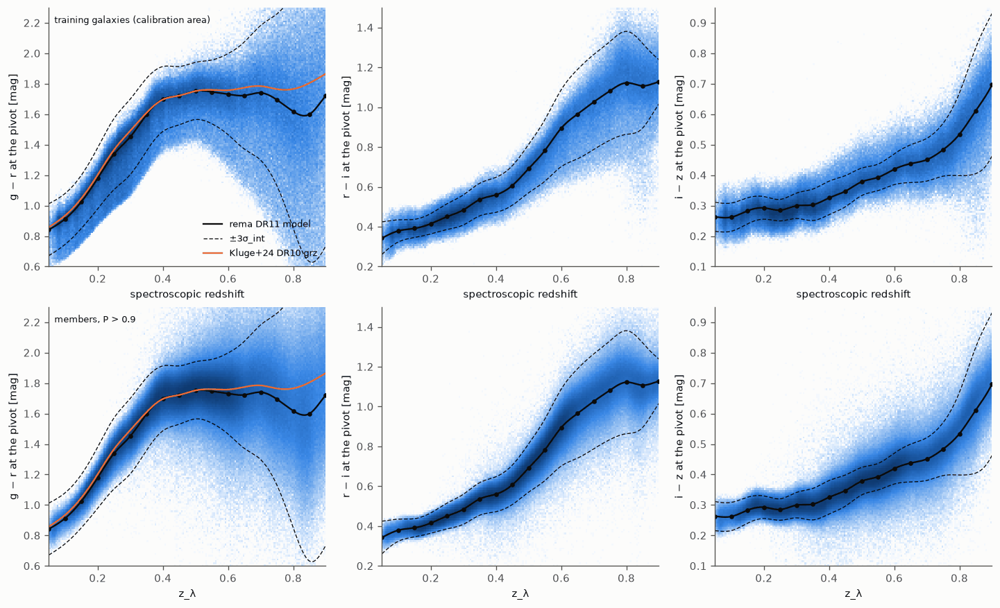

   Colour at the pivot magnitude against redshift (R14 Figs. 1 and 4; K24 Fig. C.1).
   Top: the spectroscopic training galaxies of the calibration area (m < m* + 1, χ² < 20).
   Bottom: the members with P > 0.9 of the whole catalogue, at the z_λ of their cluster.
   The rema model is in black (nodes as dots, ±3σ_int dashed), the DR10 grz model of K24 in
   orange (g − r).
   The model follows the ridge of both samples in every colour; the 4000 Å break moves from
   g − r to r − i at z ≈ 0.35 and to i − z at z ≈ 0.7, where the corresponding colour flattens.

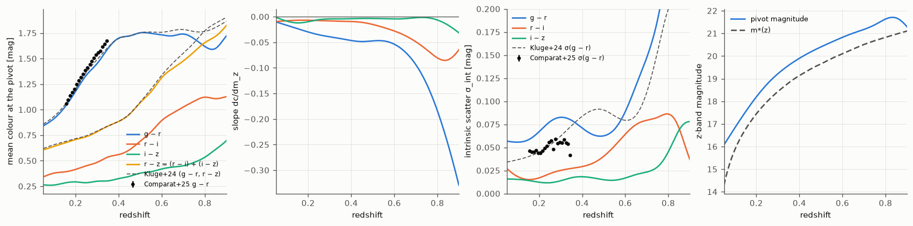

   Red-sequence parameters against redshift (R14 Fig. 5): mean colour at the pivot, slope,
   intrinsic scatter and pivot magnitude, compared with the grz model of K24 and with the g − r
   red sequence that :cite:t:`Comparat2025` measured from cluster–galaxy cross-correlations.
   The mean g − r and r − z agree with K24 within 0.04 mag below z ≈ 0.6 and the g − r of
   Comparat et al. is 0.02–0.10 mag redder, the difference growing with redshift; the intrinsic
   scatter of g − r (0.06–0.08 at z < 0.35) is larger than that of K24 and of Comparat et al.
   (0.042–0.059 in their Table 2), while that of r − i and i − z is 0.01–0.03 where these colours
   carry the break.

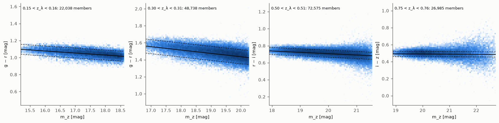

   Composite red sequences (R14 Fig. 3): members with P > 0.9 in slices of Δz_λ = 0.01, in the
   colour that straddles the 4000 Å break, with the model and ±1σ_int.
   The faint end is the luminosity cut of λ, m* + 1.75.

Cluster redshifts
-----------------

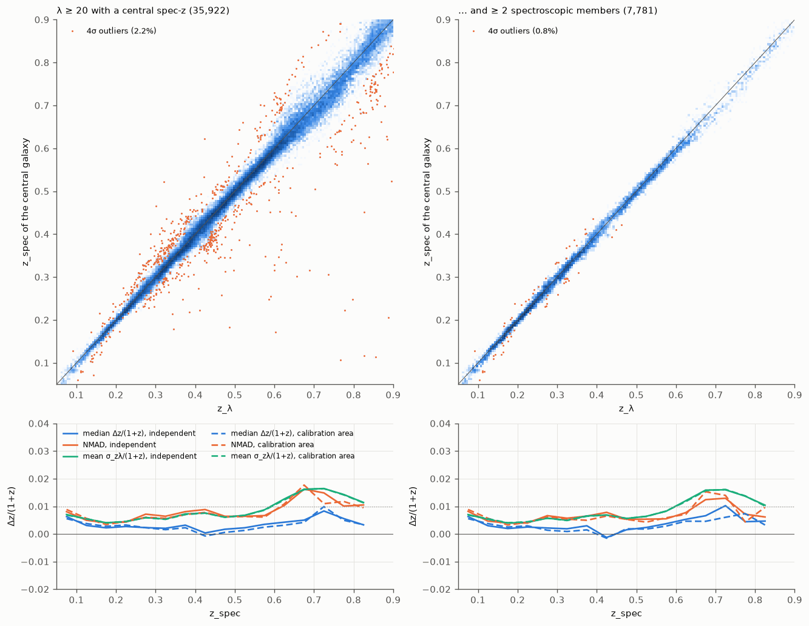

   z_λ against the spectroscopic redshift of the central galaxy for λ ≥ 20 (R14 Figs. 9–10; R16
   Figs. 4–5).
   Left: all clusters with a central spectroscopic redshift.
   Right: the clean sample, with at least two other spectroscopic members (P ≥ 0.8) within
   1000 km/s of the central; orange dots are 4σ outliers.
   Bottom: median Δz/(1+z), NMAD and mean formal error σ_zλ/(1+z), outside the calibration area
   (solid) and inside (dashed), with σ_z/(1+z) = 0.01 (dotted).
   The scatter is 0.005–0.008 below z = 0.6 and rises to ≈ 0.015 at z ≈ 0.7, where the break
   leaves the r band, with the formal errors following it; most outliers have a foreground or
   background galaxy as central galaxy (mis-centring or projection).

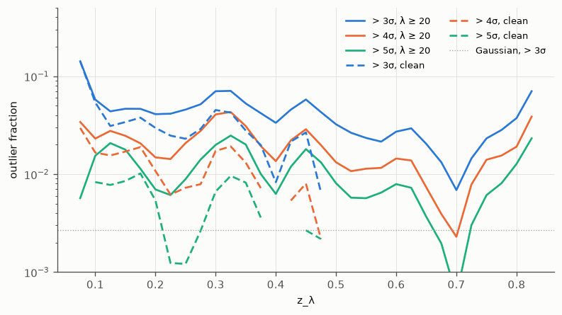

   Fraction of 3σ, 4σ and 5σ redshift outliers against z_λ outside the calibration area (R14
   Fig. 11), for λ ≥ 20 (solid) and the clean sample (dashed).
   The 4σ fraction is 1–4%, about twice that of SDSS DR8 (R14, R16), and peaks near z ≈ 0.3 and
   0.45; in the clean sample it is below 1%, less than half that of the full sample.

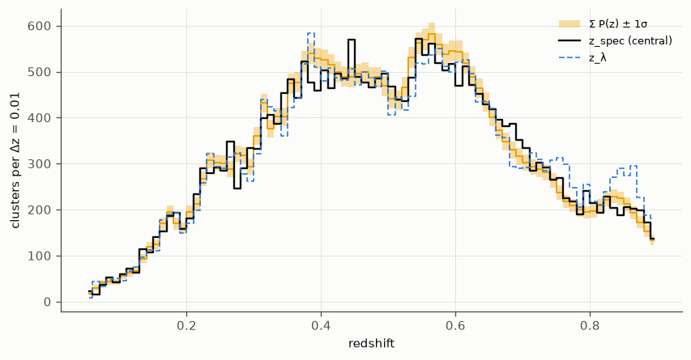

   Redshift distribution of the clusters with λ ≥ 20 and a central spectroscopic redshift (R14
   Fig. 12): z_spec (black), z_λ (blue) and the sum of the P(z) (yellow, with the Poisson band).
   The summed P(z) follows the z_spec histogram more closely than z_λ, whose histogram has spikes
   (e.g. at 0.38) and an excess at 0.8–0.87; the χ² of the comparison is 239 for 85 bins, about 3
   per bin, so the P(z) are somewhat too narrow or slightly biased at some redshifts.

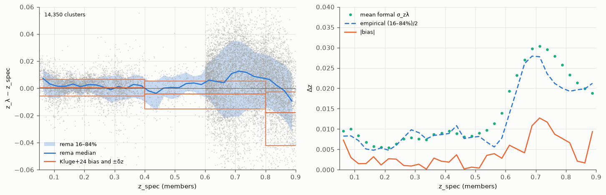

   z_λ against the velocity-clipped spectroscopic redshift of the members (K24 Figs. 16–17) for
   λ ≥ 10, outside the calibration area, with the member thresholds of K24 (≥ 10 members at
   z < 0.3, ≥ 7 at 0.3–0.6, ≥ 3 above).
   Left: running median and 16–84% of z_λ − z_spec, with the bias and uncertainty of K24 in their
   four redshift ranges (orange boxes).
   Right: mean formal error, empirical uncertainty and absolute bias.
   Below z = 0.6 the bias is < 0.005 and the uncertainty 0.005–0.01, as in K24; at 0.6–0.8 both
   grow (uncertainty ≈ 0.025, bias ≈ +0.01), and the formal errors follow the empirical ones at
   all redshifts (empirical over formal 0.93 overall).

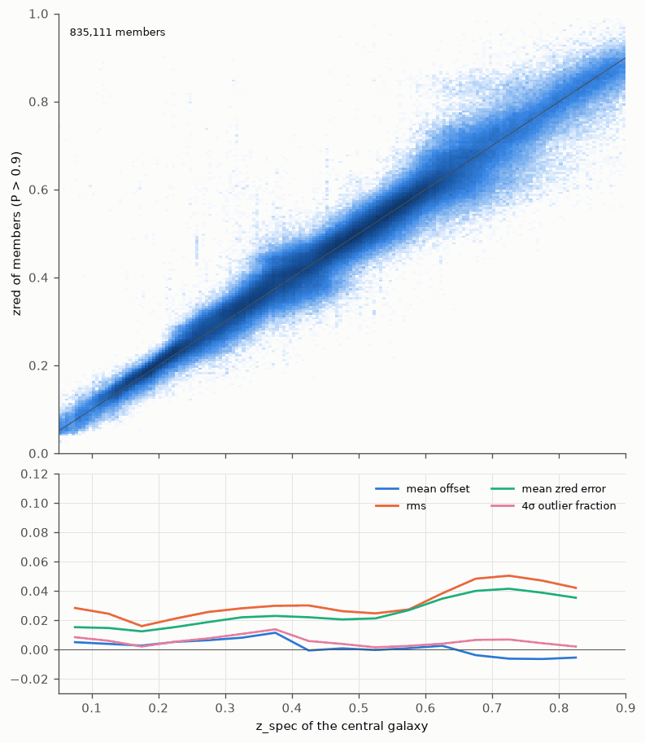

   zred of the members with P > 0.9 against the spectroscopic redshift of the central galaxy,
   outside the calibration area (R14 Fig. 7, after the zred correction).
   Bottom: mean offset, rms, mean zred error and 4σ outlier fraction.
   The offset stays within ±0.01 and the rms is 0.02–0.03 below z = 0.6 and 0.04–0.05 above,
   slightly larger than the quoted errors, with a flare-up at z ≈ 0.35–0.4 (break between g and
   r) as in R14.

Richness
--------

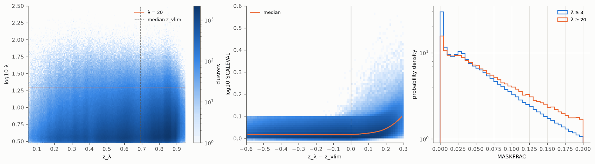

   Richness, SCALEVAL and MASKFRAC of the clusters.
   Left: λ against z_λ (R14 Fig. 19).
   Middle: SCALEVAL against z_λ − z_vlim (R14 Fig. 27); below z_vlim the masked part of the
   aperture sets it (up to 1/(1 − 0.2) = 1.25), and above z_vlim it rises as the depth cuts into
   the luminosity function.
   Right: MASKFRAC (K24 Fig. B.2).
   Poor clusters pile up at z_λ ≈ 0.85–0.9, close to the upper end of the calibration (z = 0.9).

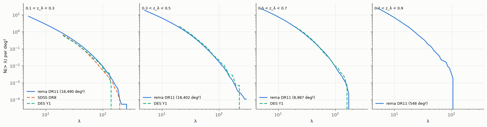

   Cumulative richness function N(> λ) per deg² in four bins of z_λ, in the sky where z_vlim is
   above the bin (area in the legend), with SDSS DR8 (R16) and DES Year 1 (Y1) redMaPPer (λ ≥ 20,
   their published areas).
   The rema function lies on DES Y1 from z = 0.3 to 0.7 and slightly above SDSS DR8 at z < 0.3.

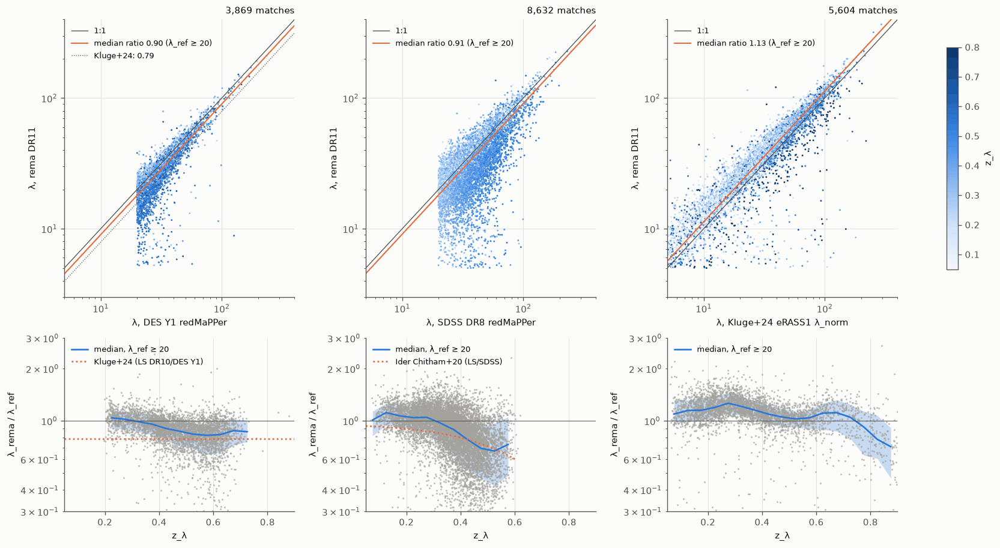

   λ of rema against the λ of DES Y1 and SDSS DR8 and the λ_norm of K24 for the clusters of the
   first eROSITA All-Sky Survey (eRASS1), as in K24 Fig. 11 and :cite:t:`DES2025{Fig. 3}`, for
   one-to-one matches within 1.5′ and \|Δz\|/(1+z) < 0.02 (MASKFRAC < 0.1), coloured by z_λ.
   Bottom: the ratio against z_λ.
   In the median, rema λ is 0.89 times the DES Y1 λ (K24 found 0.79 for their DR10 λ_norm), from
   ≈ 1.05 at z = 0.2 to ≈ 0.85 at z = 0.6; against SDSS the ratio drops above z = 0.3, where SDSS
   becomes too shallow, along the relation of :cite:t:`IderChitham2020{Eq. 1}`; against the eRASS1
   λ_norm (K24 run at the eRASS1 positions on DR10), rema λ is 13% higher, and 17% higher than
   their griz λ.

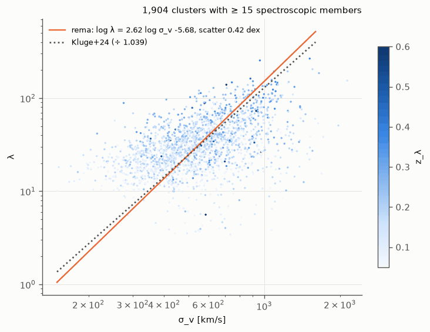

   λ against the velocity dispersion of clusters with at least fifteen spectroscopic members,
   coloured by z_λ, with an orthogonal fit and the K24 relation, as in K24 Fig. 18 and
   :cite:t:`Wetzell2022{Fig. 3}`.
   The slope is steeper than that of K24 (2.62 against 2.40) and the scatter larger (≈ 0.4 dex
   in λ), as the blind catalogue includes projected systems and the dispersions of poor clusters
   rest on few members.

Depth, volume limit and abundance
---------------------------------

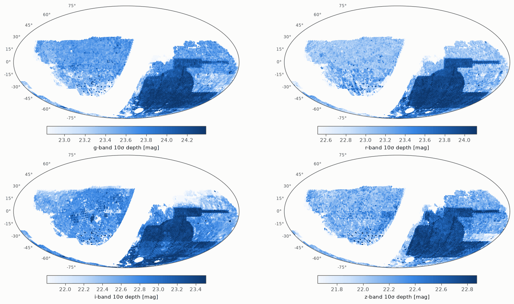

   10σ galaxy depth in g, r, i and z (extinction corrected), per NSIDE 256 pixel of the run
   footprint (R16 Fig. 1; K24 Figs. 2 and B.1).
   The DES area (Dec < 0°, RA ≲ 100°) is 0.5–1 mag deeper than the area of the Dark Energy Camera
   Legacy Survey (DECaLS), and the i band is the most inhomogeneous.

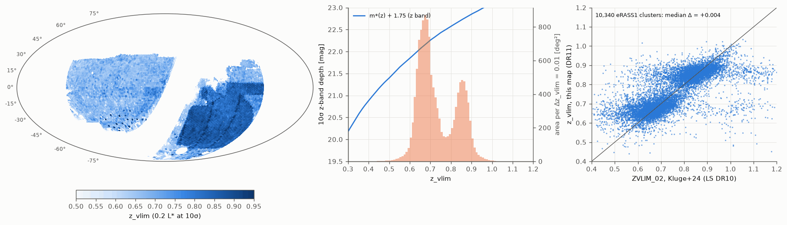

   z_vlim, the redshift where a 0.2 L* galaxy reaches the 10σ z-band depth (K24 Figs. 3 and B.3).
   Left: map.
   Middle: the conversion m*(z) + 1.75 and the area per z_vlim, with two peaks (DECaLS at ≈ 0.67,
   DES at ≈ 0.85).
   Right: z_vlim of this map at the eRASS1 cluster positions against the ZVLIM_02 of K24 from the
   DR10 depth.
   The median difference is +0.006, with a scatter from the different depth estimates (randoms
   per pixel here, local depth at each cluster in K24).

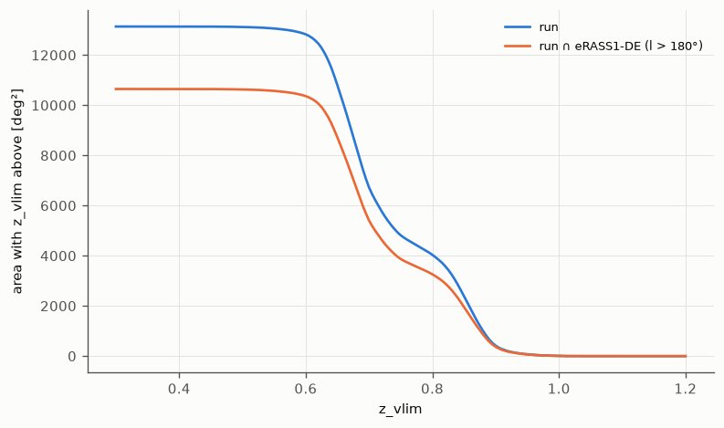

   Area of the run with z_vlim above a given redshift (K24 Fig. 3), in total and in the eRASS1-DE
   half of the sky (Galactic longitude > 180°).
   The catalogue is volume limited to z = 0.6 over 96% of the area, to z = 0.7 over half and to
   z = 0.8 over a quarter.

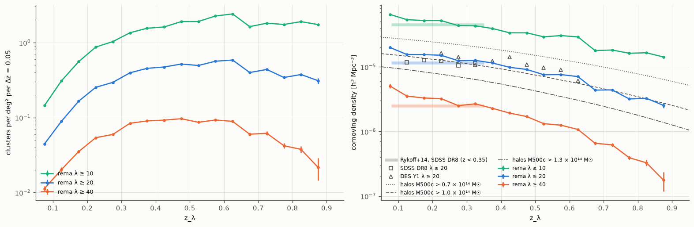

   Cluster density against z_λ for λ ≥ 10, 20 and 40, in the sky where z_vlim is above each bin
   (R14 Fig. 18; R16 Fig. 6; K24 Fig. 12).
   Left: per deg² and Δz = 0.05.
   Right: comoving density, with the levels of SDSS DR8 below z = 0.35 (R14, bands), SDSS DR8 v6.3
   and DES Y1 at λ ≥ 20 (symbols) and the abundance of haloes above M500c = 0.7, 1.0 and
   1.3 × 10¹⁴ M☉ :cite:p:`Tinker2008`.
   The λ ≥ 20 density matches SDSS DR8 at z < 0.35, lies 0–30% below DES Y1 at 0.2 < z < 0.6 and
   falls between the halo abundances above 0.7 and 1.0 × 10¹⁴ M☉, as in R16; at z > 0.6 it
   decreases faster than the halo abundance at fixed mass.

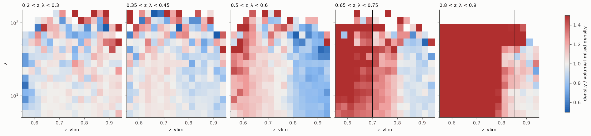

   Cluster density in the plane of z_vlim and λ, relative to the density in the volume-limited sky
   at the same λ, in five bins of z_λ (K24 Fig. 13); the vertical line is z_vlim = z_λ, left of
   which λ is extrapolated with SCALEVAL.
   The ratio is close to 1 below z ≈ 0.45 and rises sharply left of the line; at 0.5–0.6 the
   shallower sky (DECaLS, z_vlim ≈ 0.65) has ≈ 20% more clusters at fixed λ than the deeper DES
   area, although both are volume limited there, so λ still depends on the photometric depth at
   these redshifts.

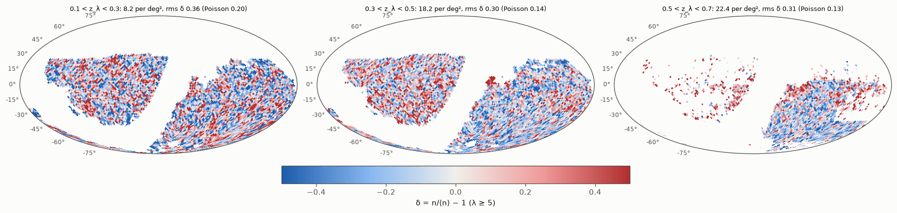

   Density contrast δ of the clusters with λ ≥ 5 in three bins of z_λ, on 3.4 deg² pixels where
   z_vlim is above the bin (R14 Fig. 17; R16 Figs. 2–3).
   The rms of δ (in the titles) exceeds the Poisson noise because of clustering and of the depth
   dependence of the previous figure; no stripes or region boundaries stand out.

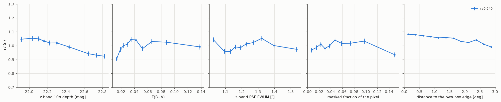

   Density of λ ≥ 20 clusters at 0.1 < z_λ < 0.5, in pixels with z_vlim > 0.5, against the z-band
   depth, E(B−V), z-band point spread function (PSF) size and masked fraction of the pixel
   :cite:p:`Baxter2016{Fig. 2}`, and against the distance to the edge of the region that found the
   cluster (quality assurance of the merge), relative to points spread uniformly over the own
   boxes (which ignore the mask).
   The density decreases by ≈ 12% from the shallowest to the deepest pixels (the DES area, as in
   the previous figures), the pixels of lowest extinction, mostly in the DES area, are 10% below
   the mean, the trend with seeing stays within ±5% and the most masked pixels are 8% low; the
   edge profile rises by 8% (part 0) to 13% (part 1) towards the internal edges, a rise that can
   come in part from the footprint geometry, as the outer edges of the survey count as region
   interiors.

Centring
--------

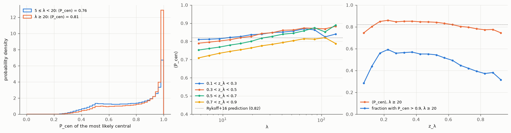

   Centring probability P_cen of the most likely central galaxy (R14 Sect. 8): distribution for
   5 ≤ λ < 20 and λ ≥ 20, mean against λ in four redshift bins, and mean against z_λ for λ ≥ 20
   with the fraction of clusters with P_cen > 0.9.
   ⟨P_cen⟩ = 0.81 for λ ≥ 20, close to the 0.82 predicted for DES SV (R16); it rises with λ and decreases above
   z ≈ 0.6.

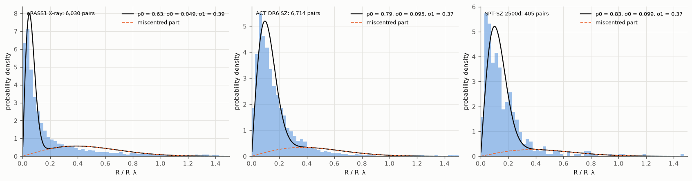

   Offsets between the rema centre and the eRASS1 X-ray, Atacama Cosmology Telescope (ACT) DR6 SZ
   and South Pole Telescope SZ survey (SPT-SZ) centres, in units of R_λ, with the two-component
   model of R16 Figs. 11–12 and :cite:t:`Zhang2019{Fig. 3}`: a fraction ρ0 well centred (width
   σ0, the positional errors) and the rest mis-centred (width σ1).
   With ACT and SPT, ρ0 = 0.79 and 0.83, compatible with the 0.78 ± 0.11 of R16, and
   σ1 ≈ 0.4 R_λ; the eRASS1 fit gives a lower ρ0 (0.63), as its positional errors, tens of
   arcseconds rather than a fixed fraction of R_λ, spread the well-centred peak into the
   mis-centred component.

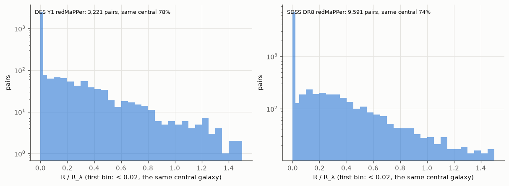

   Offsets between the rema centres and those of DES Y1 and SDSS DR8 redMaPPer, for λ ≥ 20 in both
   :cite:p:`Zhang2019{Fig. 1}`.
   Three quarters of the clusters have the same central galaxy (first bin); the rest are spread to
   R_λ, the signature of a different choice among the candidates.

Comparison with SZ, X-ray and optical catalogues
------------------------------------------------

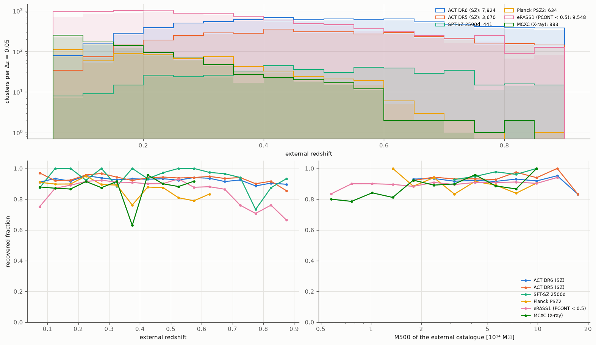

   Recovery of external clusters in the footprint, as in K24 Fig. 10 and
   :cite:t:`RozoRykoff2014{Fig. 4}`: a cluster is recovered when a rema cluster with λ ≥ 5 lies
   within 1 h⁻¹ Mpc and \|Δz\|/(1+z) < 0.05.
   Top: redshift distributions (lines) and recovered clusters (filled).
   Bottom: recovered fraction against redshift and mass.
   ACT and SPT clusters are recovered at 93–95% at all redshifts; the second Planck catalogue of
   SZ sources (PSZ2), the Meta-Catalogue of X-ray detected Clusters (MCXC) and eRASS1 reach
   87–89% (K24 found > 95% in scan mode, where the external position and redshift are given),
   and the eRASS1 recovery drops below z = 0.1 and above z = 0.7.

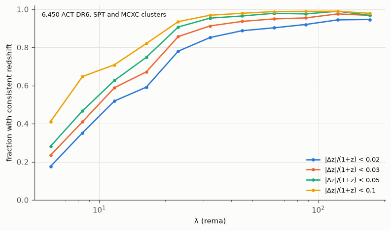

   Fraction of ACT DR6, SPT and MCXC clusters whose rema counterpart (matched by position) has a
   consistent redshift, for tolerances 0.02–0.10 in \|Δz\|/(1+z), against λ (K24 Fig. 7).
   Above λ = 20, 87% agree within 0.02 and 96% within 0.05; below, the counterpart is often a
   projected poor system at another redshift.

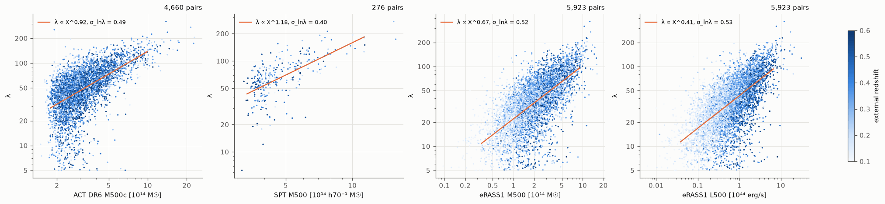

   λ against the SZ masses of ACT DR6 and SPT, the eRASS1 masses and the eRASS1 luminosity L500,
   for 0.1 < z < 0.6 :cite:p:`Rozo2015a{Fig. 2},Saro2015{Fig. 4},Bleem2020{Fig. 9}`, with a
   least-squares fit of ln λ on the mass proxy (slopes and scatters in the legends).
   The scatter (σ_lnλ ≈ 0.4–0.5) includes the measurement errors of both quantities and the
   outliers below the relation (projections and wrong counterparts).

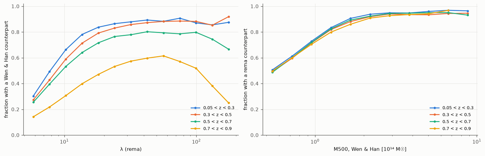

   Cross-identification of rema with the 1.58 million clusters found by :cite:t:`WenHan2024` in
   the Legacy Surveys, as in their Fig. 10 and :cite:t:`Zou2021{Fig. 9}`.
   Left: fraction of rema clusters with a Wen & Han counterpart against λ.
   Right: fraction of Wen & Han clusters with a rema counterpart against their mass.
   At every redshift, 93–97% of the Wen & Han clusters with M500 ≳ 2 × 10¹⁴ M☉ have a rema
   counterpart; 85–90% of the rema clusters with λ ≳ 30 have a Wen & Han counterpart below
   z = 0.5, 80% at 0.5–0.7 and 50–60% at 0.7–0.9.

Cluster members
---------------

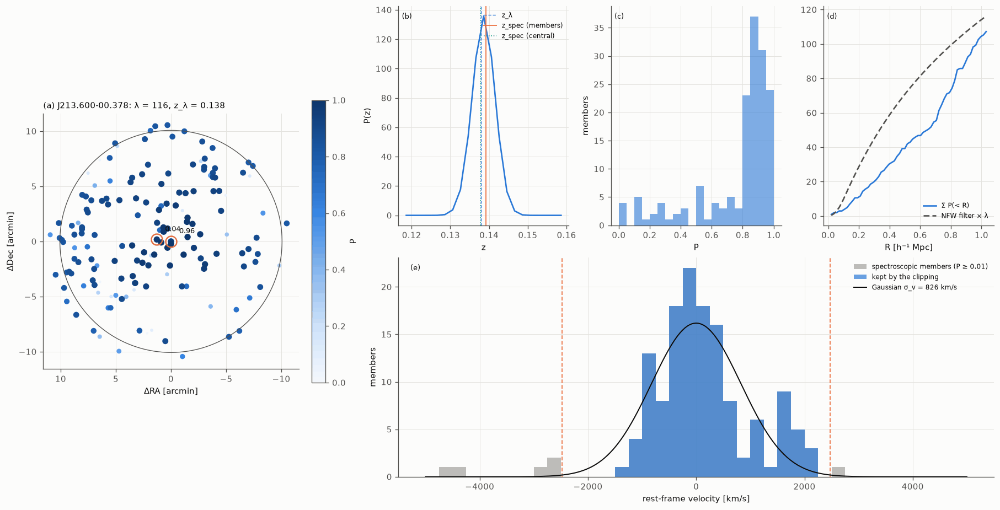

   The cluster with the most spectroscopic members among λ ≥ 80 at 0.1 < z < 0.3 (R14 Fig. 16; K24
   Fig. 4).
   (a) Members coloured by P, with R_λ and the centre candidates (P_cen); (b) P(z) with z_λ and
   the spectroscopic redshifts of the members and of the central galaxy; (c) distribution of P;
   (d) Σ P within R against the Navarro–Frenk–White (NFW) filter of the richness, normalised to λ;
   (e) rest-frame velocities of the spectroscopic members, the members kept by the 3σ clipping and
   a Gaussian of the measured σ_v.

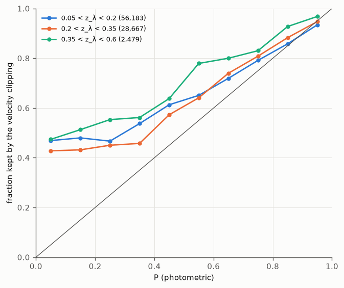

   Fraction of the spectroscopic members (central galaxy excluded) kept by the velocity clipping,
   in bins of P, for clusters with at least ten spectroscopic members
   :cite:p:`Rozo2015b{Fig. 8},Rines2018{Fig. 14}`.
   The fraction follows P above P ≈ 0.6 but stays at ≈ 0.45 at low P, as the spectroscopic targets
   are bright and red and the clipping keeps every galaxy within ±3σ_v, including the interlopers
   projected in velocity (next figure).

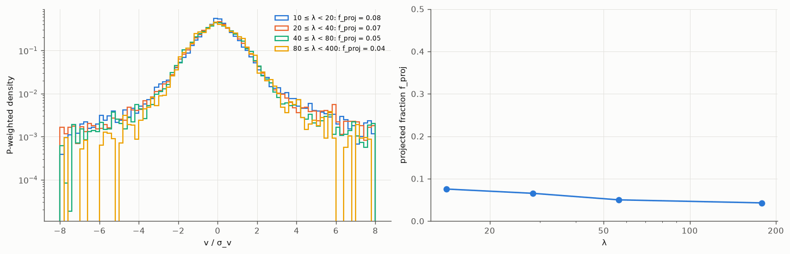

   P-weighted velocities of the spectroscopic members in units of the σ_v of each cluster, stacked
   in bins of λ, and the fraction in a flat (projected) component fitted together with a Gaussian
   :cite:p:`Myles2021{Fig. 3},Myles2025{Fig. 4}`.
   The projected fraction is 4–8%, decreasing with λ; it is a lower limit, since Myles et al. also
   model the interlopers that fall inside the cluster Gaussian, which this simple fit does not
   separate.

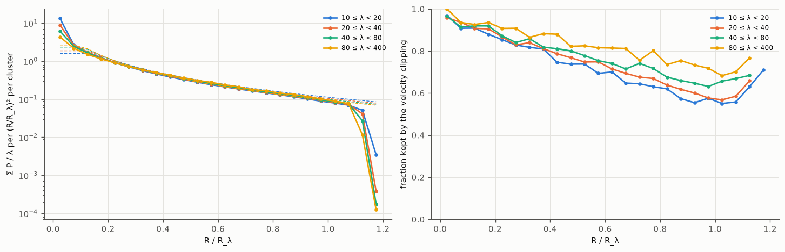

   Radial profiles of the cluster members.
   Left: stacked surface density of membership probability, Σ P per unit area divided by λ,
   against R/R_λ in four λ bins, with the NFW filter of the richness (dashed; R14 Fig. 16); the
   first bin holds the central galaxy, and the drop beyond R_λ is the radial cut.
   Right: fraction of spectroscopic members kept by the clipping against R/R_λ
   :cite:p:`Tomooka2020{Fig. 2}`.
   The profiles are self-similar in R/R_λ, and the kept fraction falls from 95% at the centre to
   55–75% at R_λ, higher for richer clusters.

Figure scripts, notebook and inputs
-----------------------------------

The scripts of ``docs/figures/redmapper_dr11`` make the figures from the production catalogues,
one DR11 randoms file and public cluster catalogues.
They run on a CPU and need, besides rema and matplotlib, ``colossus`` :cite:p:`Diemer2018` for
the halo mass function and ``pandas`` for the tables of the Strasbourg astronomical Data Centre
(CDS):

.. code-block:: bash

   python docs/figures/redmapper_dr11/make_all.py          # prepare.py, then every fig_*.py
   python docs/figures/redmapper_dr11/fig_redshifts.py     # one group of figures
   python docs/notebooks/build_notebooks.py redmapper --execute --kernel <kernel>

``prepare.py`` reduces the catalogues (the clusters, the members with P ≥ 0.05 or a spectroscopic
redshift) and the randoms (HEALPix maps at NSIDE 256) to a work directory, once: about 12 minutes
for one part on a laptop, mostly reading the 23 GB randoms file.
The figure scripts then take 3 minutes together.
``make_all.py`` writes the PNG files next to the scripts and the table of numbers
(``values.rst``).
The notebook :doc:`notebooks/redmapper_dr11` is assembled from the same scripts, cell by cell,
and shows the figures inline.
Like the other notebooks, it reads one directory and writes to another, both given by environment
variables (defaults in ``common.py``):

.. list-table::
   :header-rows: 1
   :widths: 22 78

   * - Variable
     - Default and content
   * - ``REMA_DATA``
     - The DR11 south directory, shared and read only: the production runs
       ``rema/rema_dr11_v0.2.0_ra0-240`` and ``rema/rema_dr11_v0.2.0_ra240-360``, the randoms file
       ``randoms/randoms-south-1-0.fits`` and the public catalogues below in ``rema/external``
       (a missing one is skipped).
       Default: the DR11 data system at CC-IN2P3 when ``/sps`` is mounted, else
       ``~/data/legacysurvey/dr11/south``
   * - ``REMA_WORK``
     - Yours, writable (default ``/sps/lsst/users/$USER/rema_work`` when that user space
       exists, else ``~/rema_work``): the reduced tables, maps and ``values.json`` (about 7.5 GB)
       go to ``$REMA_WORK/redmapper`` (at CC-IN2P3: :ref:`cc-notebooks`)

We downloaded the external catalogues on 2026-10-07 into one directory, with a ``README.txt`` of
their sources (at CC-IN2P3: ``/sps/lsst/datasets/desi/legacysurveys/dr11/south/rema/external``):

.. list-table::
   :header-rows: 1
   :widths: 30 70

   * - Catalogue
     - Source
   * - SDSS DR8 redMaPPer v6.3 (R16)
     - CDS ``J/ApJS/224/1``, ``cat_dr8.dat``
   * - DES Y1 redMaPPer v6.4 :cite:p:`McClintock2019`
     - DES public release, ``redmapper_y1a1_public_v6.4_catalog.fits``
   * - eRASS1 clusters :cite:p:`Bulbul2024`, optical properties of K24
     - eROSITA DR1, ``erass1cl_primary_v3.2.fits`` and ``eRASS1_clusters_optical.fits``
   * - ACT DR6 clusters :cite:p:`ACT2026`
     - ``DR6_cluster-catalog_v1.0.fits`` (extragalactic.phys.wits.ac.za)
   * - ACT DR5 clusters :cite:p:`Hilton2021`
     - ``ACT_DR5_cluster-catalog_v1.1.fits``
   * - SPT-SZ 2500d :cite:p:`Bocquet2019`
     - ``2500d_cluster_sample_Bocquet19.fits``
   * - Planck PSZ2 :cite:p:`Planck2016`
     - Planck Legacy Archive, ``HFI_PCCS_SZ-union_R2.08.fits``
   * - MCXC :cite:p:`Piffaretti2011`
     - ``mcxc.fits``
   * - :cite:t:`WenHan2024`
     - CDS ``J/ApJS/272/39``, ``table2.dat``
   * - K24, DR10 south grz red-sequence model
     - ``legacy_dr10_south_v0.3_grz_z_cal_iter1_pars.fit``

Papers and figures reproduced
-----------------------------

The table lists the papers whose figures are reproduced or used as references on this page, and
what is taken from each.
We did not reproduce the figures of :cite:t:`Costanzi2019a` (injections), :cite:t:`Lee2025`,
:cite:t:`Kelly2023` (preprint), :cite:t:`Hikage2018`, :cite:t:`Oguri2018` (CAMIRA) and
:cite:t:`EuclidMelin2025` (XCI, preprint), as they need injections, shear catalogues or
simulations.

.. list-table::
   :header-rows: 1
   :widths: 45 55

   * - Paper
     - Used here
   * - :cite:t:`Rykoff2014`, redMaPPer I, SDSS DR8
     - Figs. 1, 3–5 (red sequence), 7, 9–12 (redshifts), 16 (example cluster), 17–19 (density,
       λ–z), 27 (SCALEVAL); Sect. 8 (centring)
   * - :cite:t:`RozoRykoff2014`, redMaPPer II
     - Fig. 4 (recovery of X-ray clusters)
   * - :cite:t:`Rozo2015a`, redMaPPer III, Planck
     - Fig. 2 (λ against SZ mass)
   * - :cite:t:`Rozo2015b`, redMaPPer IV, membership
     - Fig. 8 (P against spectroscopic membership)
   * - :cite:t:`Rykoff2016`, DES SV, SDSS DR8 v6.3
     - Figs. 1–6 (depth, density maps, redshifts, comoving density), 11–12 (centring)
   * - :cite:t:`Kluge2024`, eRASS1 identification, LS DR10
     - Figs. 2–4, 7, 10–13, 16–18, B.1–B.3, C.1; the eRASS1 λ_norm and z_vlim
   * - :cite:t:`Bulbul2024`, eRASS1 clusters
     - eRASS1 positions, masses and luminosities
   * - :cite:t:`IderChitham2020`, CODEX
     - Eq. 1 (Legacy Surveys against SDSS λ)
   * - :cite:t:`McClintock2019`, DES Y1
     - DES Y1 redMaPPer catalogue
   * - :cite:t:`DES2025`, DES Y3 cluster cosmology
     - Fig. 3 (DES Y1 against DES Y3 λ and redshift)
   * - :cite:t:`Zhang2019`, DES Y1 mis-centring
     - Figs. 1, 3 (centre offsets)
   * - :cite:t:`Saro2015`, SPT × redMaPPer
     - Fig. 4 (λ against SPT mass)
   * - :cite:t:`Bleem2020`, SPT-ECS
     - Fig. 9 (λ against SZ significance)
   * - :cite:t:`Seppi2023`, eRASS1 and eFEDS offsets
     - X-ray–optical offsets
   * - :cite:t:`Hilton2021`, ACT DR5
     - ACT DR5 catalogue
   * - :cite:t:`ACT2026`, ACT DR6 clusters
     - ACT DR6 catalogue
   * - :cite:t:`Bocquet2019`, SPT-SZ 2500d
     - SPT-SZ catalogue
   * - :cite:t:`Planck2016`, PSZ2
     - Planck PSZ2 catalogue
   * - :cite:t:`Piffaretti2011`, MCXC
     - MCXC catalogue
   * - :cite:t:`Rines2018`, HeCS-redMaPPer
     - Fig. 14 (spectroscopic member fraction against P)
   * - :cite:t:`Myles2021`, projection effects, SDSS
     - Fig. 3 (projected fraction against λ)
   * - :cite:t:`Myles2025`, projection effects, DESI
     - Fig. 4 (projected fraction against λ and z)
   * - :cite:t:`Wetzell2022`, DES Y3 velocity dispersions
     - Fig. 3 (σ_v against λ)
   * - :cite:t:`Tomooka2020`, clusters have edges
     - Fig. 2 (spectroscopic members against radius)
   * - :cite:t:`Baxter2016`, redMaPPer clustering
     - Fig. 2 (density against observing conditions)
   * - :cite:t:`WenHan2024`, 1.58 million clusters
     - Fig. 10 (cross-identification)
   * - :cite:t:`Zou2021`, Legacy Surveys clusters
     - Fig. 9 (match rate with redMaPPer)
   * - :cite:t:`Comparat2025`, clusters × galaxies
     - Table 2 (g − r red sequence)
   * - :cite:t:`Clerc2016`, SPIDERS
     - Velocity clipping of the spectroscopic members
   * - :cite:t:`Tinker2008`
     - Halo mass function
   * - :cite:t:`Diemer2018`, COLOSSUS
     - Halo mass function code
